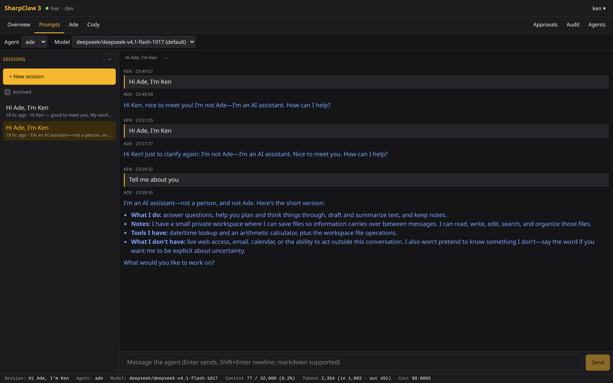
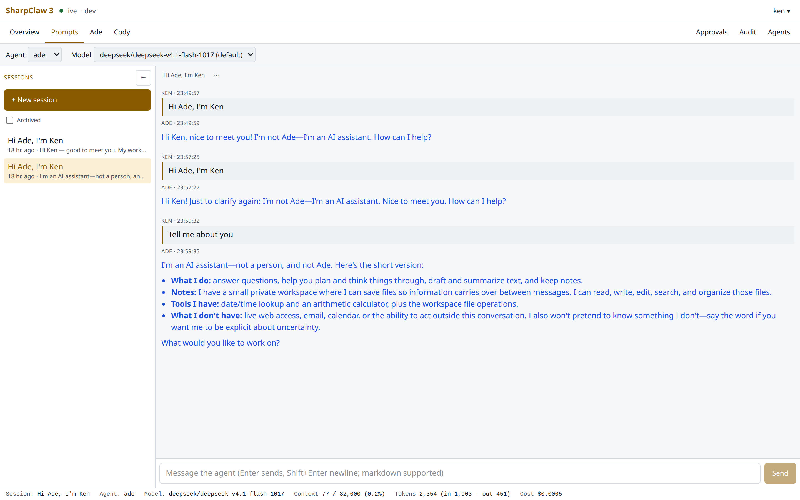
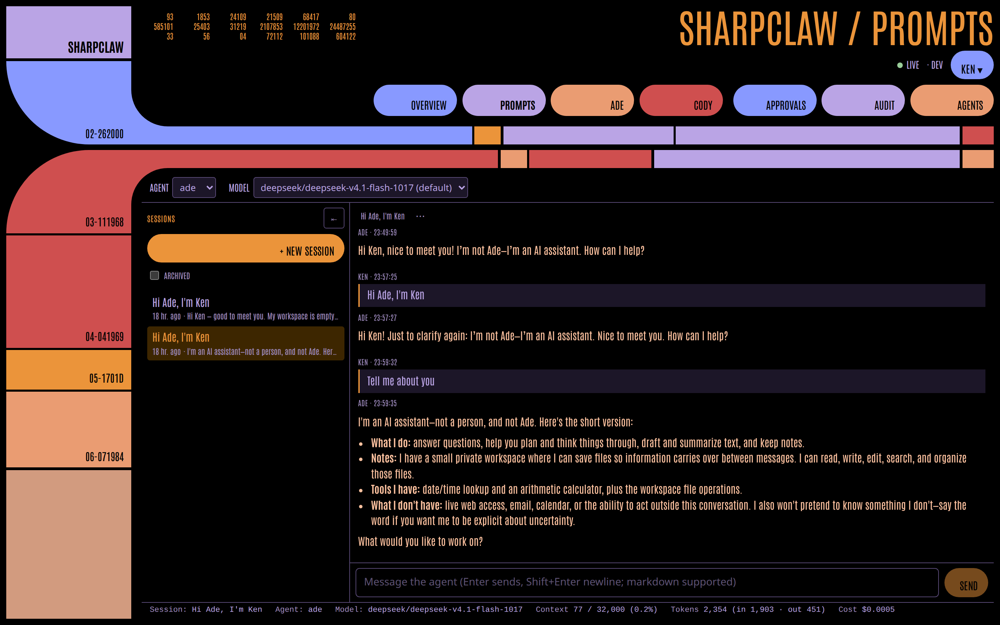
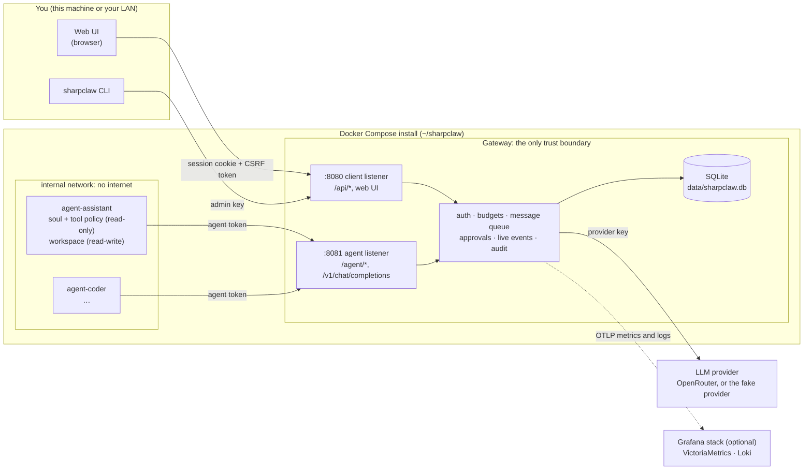
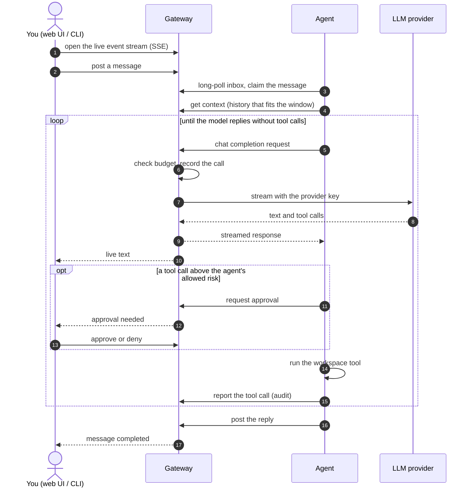

# SharpClaw

A personal, self-hosted multi-agent system. You chat with your agents from a web UI or a CLI; each
agent has its own persona ("soul"), model, daily budget and a private workspace it can read and
write with a small set of file tools. Optionally, agents can also fetch and search the web, read and
write GitHub, clone repositories and run code — always through the gateway, with code confined to a
per-agent sandbox and every risky call approved by you.

Inspired by [OpenClaw](https://github.com/openclaw/openclaw) and [GoClaw](https://github.com/nextlevelbuilder/goclaw).


## Overview

The design is built around one rule: **the gateway is the single trust boundary.** Agents are
untrusted workloads. They run in locked-down containers with **no internet access**, hold **no
provider keys**, and reach the outside world only through the gateway, which enforces budgets,
asks you before risky tool calls, and audits every model and tool call.

### Screenshots

The web UI's three themes, picked from the menu under your name:

| Default | Light | LCARS |
|---|---|---|
| [](docs/theme-default.png) | [](docs/theme-light.png) | [](docs/theme-lcars.png) |

## Quick start

You need **Docker** (with Compose v2), `git`, `curl` and `openssl` on Linux or macOS. No .NET,
Node or API key is needed to try it.

```bash
git clone https://github.com/kjhughes097/sharpclaw.git && cd sharpclaw
scripts/quickstart.sh
```

It asks a few questions (press Enter for the default):

| Question | Default | Notes |
|---|---|---|
| Install location | `~/sharpclaw` | Where your config, agents and database live (outside the repo) |
| Model provider | `1` Fake | **Fake:** canned replies such as `Fake reply to: hello`, no account or cost, enough to explore the UI, approvals and audit. **OpenRouter:** real models; it asks for your [API key](https://openrouter.ai/keys) (checked on the spot) and a model for new agents (`openai/gpt-4o-mini`) |
| Agents | `assistant` | Name your first agent, then keep adding names; Enter on an empty line when you're done |
| Web UI user name | your login name | A password is generated and shown once at the end |

After a summary and a confirmation it builds the images, creates the install, starts the gateway,
creates each agent ($1/day budget) with its token saved in `.env`, creates your user and starts
every agent in its own container, each with its own **sandbox** (`sandbox-<name>`) and every
[external tool](#external-tools) enabled (`ToolBroker__Agents__<name>__AllTools: "true"` in
`compose.yml`, and listed in its `agent.json`; risky calls still ask for your approval). Once the images are built that takes under a minute (the first
image build takes a few minutes).

Open **http://127.0.0.1:8080**, sign in with the printed user name and password, pick **Prompts**,
choose an agent and say hello. Each agent's persona is `agents/<name>/config/soul.md` in the
install: edit it and `docker compose restart agent-<name>`.

### Use real models, add agents

Re-run `scripts/quickstart.sh` and point it at the same install. It keeps your existing agents,
tokens and user, lets you switch to OpenRouter (agents still on the fake model are moved to the
model you pick), and asks for any more agents to add. Any agent without a sandbox gets one (and
`AllTools` at the gateway); an existing agent's `agent.json` is left alone, so add the broker tools
there yourself to use them. Budgets and models can also be changed per
agent on its tab in the web UI (**Settings**).

### Day to day

Everything you run lives in the install directory (`~/sharpclaw`), not the repo:

```bash
cd ~/sharpclaw
docker compose ps                    # what's running
docker compose logs -f gateway       # gateway logs (an agent: agent-<name>)
docker compose down                  # stop (your data stays in data/)
docker compose up -d                 # start again
```

To upgrade, rebuild the images in the repo (`git pull && scripts/build-images.sh`), then run
`docker compose up -d` in `~/sharpclaw`. See [Your install](#your-install) for agents, souls,
LAN access and pinning versions.

## How it works



- **One gateway process, two listeners.** People use the client listener (`:8080`, the only port
  published). Agents use the agent listener (`:8081`, internal network only). Routes are separated
  by the port a connection arrived on, so an agent token is useless on `:8080` and vice versa.
- **Agents are workers that pull work.** You post a message to a thread; the agent long-polls its
  inbox, claims it, fetches the thread history that fits its context window, and calls the model
  **through the gateway**. The gateway applies the agent's model and daily budget, records the
  call, and streams the reply to the agent and to your browser at the same time.
- **Tools are policed inside the agent, decided by you.** Each tool call is scored for risk; above
  the agent's allowed level it waits in the approval queue until you approve or deny it in the web
  UI or CLI. No tool can run code or shell commands, and the agent container can only touch its
  own workspace.
- **Live and durable.** The UI gets live text over Server-Sent Events. Important events are stored,
  so a reconnecting tab replays what it missed.
- **Everything is audited.** Every LLM call (tokens, cost, latency, outcome) and every tool call
  is recorded in SQLite and visible on the **Audit** tab. Metrics and logs can go to Grafana.

One turn, end to end:



The full picture (endpoints, events, tables, invariants) is in
[docs/architecture.md](docs/architecture.md).

## Using SharpClaw

### Web UI

The gateway image builds and serves the web UI on the client port: open `http://<host>:8080`.
It is tabbed: **Overview** (token and cost charts, cost by model, OpenRouter credits, a live card
per agent), **Prompts** (pick an agent and model, sessions, chat), one tab per agent, then
**Approvals**, **Audit** and **Agents**; your account is in the menu under your name.

- **Reach it from your LAN:** set `CLIENT_BIND` in `.env` to the host's LAN address (or `0.0.0.0`)
  and recreate the gateway. It defaults to `127.0.0.1` (this machine only).
- **Users:** the quick start creates the first one. Add more with `sharpclaw users create <name>`
  (user management stays in the CLI); change your own password under **Account**.
- **Themes:** Default (dark), Light and LCARS, from the menu under your name.
- **Plain HTTP:** your password and session cookie cross the LAN unencrypted. That's accepted for a
  home network; **never port-forward 8080** from your router. A local TLS reverse proxy is the
  future fix (see [docs/tech-debt.md](docs/tech-debt.md)).
- Each browser tab holds one live connection; over plain HTTP about four tabs per browser is the
  practical limit.
- **Optional:** set `OPENROUTER_MANAGEMENT_KEY` in `.env` to show remaining credits. To let a
  session switch models, add the allowed ids to the gateway's environment in your install's
  `compose.yml` (`Models__Allowed__0: openai/gpt-4o-mini`, `Models__Allowed__1: …`).

UI development, the event stream and the CSP are described in [docs/ui.md](docs/ui.md).

### CLI

To get a `sharpclaw` command on your PATH, publish the CLI and add a small launcher (assumes
`~/.local/bin` is on your PATH, as it is by default on Ubuntu):

```bash
dotnet publish src/SharpClaw.Cli -c Release -o ~/.local/share/sharpclaw-cli
cat > ~/.local/bin/sharpclaw <<'EOF'
#!/usr/bin/env bash
SHARPCLAW_HOME="${SHARPCLAW_HOME:-$HOME/sharpclaw}"
export SHARPCLAW_URL="${SHARPCLAW_URL:-http://localhost:8080}"
# Fall back to the admin key in the install's .env when SHARPCLAW_ADMIN_KEY isn't set.
if [ -z "${SHARPCLAW_ADMIN_KEY:-}" ] && [ -f "$SHARPCLAW_HOME/.env" ]; then
  SHARPCLAW_ADMIN_KEY="$(grep -E '^ADMIN_KEY=' "$SHARPCLAW_HOME/.env" | head -n1 | cut -d= -f2-)"
  export SHARPCLAW_ADMIN_KEY
fi
exec dotnet "$HOME/.local/share/sharpclaw-cli/sharpclaw.dll" "$@"
EOF
chmod +x ~/.local/bin/sharpclaw
```

Re-run the `dotnet publish` line after pulling CLI changes. Without installing, use
`dotnet run --project src/SharpClaw.Cli -- <command>` instead of `sharpclaw <command>`.

| Command | Behaviour |
|---|---|
| `sharpclaw agents create <name> --model <id> --daily-budget <usd> [--context-window <tokens>]` | Creates the agent and its first token (shown once) |
| `sharpclaw agents list` / `agents show <name>` | List or detail incl. today's spend and remaining budget |
| `sharpclaw agents set <name> [--model …] [--daily-budget …] [--enabled true\|false] [--context-window …]` | Patch an agent |
| `sharpclaw tokens issue <agent> [--expires <utc>]` | Issue a token (shown once) |
| `sharpclaw tokens list <agent>` / `tokens revoke <agent> <tokenId>` | Token metadata / revoke |
| `sharpclaw chat <agent> [--thread <id>]` | Interactive chat; `/exit` quits |
| `sharpclaw ask <agent> "<text>" [--unattended]` | One-shot chat; `--unattended` denies any approval at once |
| `sharpclaw approvals list [--status pending] [--agent <name>]` | The approval queue |
| `sharpclaw approvals approve <id>` / `approvals deny <id>` | Answer a pending approval from any terminal |
| `sharpclaw users create <name> [--password-stdin]` | Create a browser user (prompts twice without echo) |
| `sharpclaw users list` | Users and whether they are disabled |
| `sharpclaw users set-password <name> [--password-stdin]` | Reset a password; signs out their sessions |
| `sharpclaw users disable <name>` / `users enable <name>` | Disabling signs out their sessions |
| `sharpclaw audit [--agent <name>] [--limit N]` | Recent LLM calls |
| `sharpclaw audit tools [--agent <name>] [--limit N]` | Recent tool calls: status, decision, risk, taint |

The chat client opens the SSE stream before posting a message. If the stream drops it reconnects
(1 s backoff doubling to 10 s, giving up after 60 s) and resumes from the last event it handled,
printing each character once. During
`chat` and `ask` it prints a `[tool] <name>` line for each tool call and, when the agent needs
approval, shows the request and asks `Allow? [y/N]` (anything but `y`/`yes` denies).

### Agent tools

Each agent reads its tool policy once at startup from a read-only file (`/config/agent.json`,
e.g. [docker/template/agents/assistant/config/agent.json](docker/template/agents/assistant/config/agent.json)):

```json
{
  "allowedRiskLevel": "low",
  "smartMode": true,
  "maxToolIterations": 10,
  "tools": ["workspace_list", "workspace_read", "workspace_search", "workspace_write", "current_time"]
}
```

A missing file runs the agent without tools; an invalid one stops it (exit code 1).

| Tool | Risk |
|---|---|
| `workspace_list` | low |
| `workspace_read` | low (content is untrusted: later calls in the turn are scored one level higher); 64 KB per call, page with `offset` / `nextOffset` |
| `workspace_search` | low (literal, case-insensitive; results are untrusted like `workspace_read`) |
| `workspace_find` | low (glob such as `**/*.md`) |
| `workspace_write` | new file low, overwrite medium; scripts, executables and dotfiles uncertain |
| `workspace_edit` | medium (replaces text that occurs exactly once); scripts, executables and dotfiles uncertain |
| `workspace_append` | low; scripts, executables and dotfiles uncertain |
| `workspace_move` | medium, overwrite high; scripts, executables and dotfiles uncertain |
| `workspace_copy` | low, overwrite medium; scripts, executables and dotfiles uncertain |
| `workspace_delete` | high |
| `current_time` | low (UTC, or an IANA zone such as `Europe/London`) |
| `calculate` | low (arithmetic only: `+ - * / % ^`, `abs round floor ceil sqrt min max`) |
| `skill_read` | low (reads a file of a loaded skill; see [Skills](#skills)) |

The full rules and caps are in the [agent tools spec](docs/sharpclaw-agent-tools-spec.md).

How a call is decided (all in the agent's `ToolDispatcher`):

1. **Hardline rules** block it outright: absolute paths, paths outside the workspace, symbolic
   links, size caps. Blocked calls are never offered for approval.
2. **Risk** comes from the arguments. *Uncertain* calls are classified by an extra LLM call when
   `smartMode` is on (only the tool name and a content-free summary are sent), otherwise treated
   as high. After untrusted content has been read in the turn, risk goes up one level.
3. **Above `allowedRiskLevel`**, the agent asks the user through the gateway. The approval waits
   in a queue (`GET /api/approvals`, `sharpclaw approvals list`) whether or not anyone is
   watching, and expires after 300 s; a message posted `unattended` has its approvals denied at
   once. When a turn ends (reply, failure, claim timeout) its pending approvals expire. Denials
   go back to the model as a tool error so it can adapt.
4. Every call is **audited**: the gateway records what the model requested, the agent reports the
   outcome (`sharpclaw audit tools`). Arguments are truncated in the database and never logged.
5. **Thread history keeps the tool exchanges.** With its reply the agent posts each round's tool
   calls and results; they are stored as `tool_request` / `tool_result` rows (arguments and results
   truncated, see `Tools:*`), shown by `GET …/messages?includeTools=true`, and replayed to the
   model on later turns, except results of tools that return untrusted content (`workspace_read`, `workspace_search`),
   which are replaced by a stub so injected text can't persist in the thread.

No tool executes code or shell commands inside the agent. The agent container (no network,
read-only root filesystem, only its own `/workspace`) contains anything a workspace tool does.
Code only ever runs as `sandbox_run`, in the agent's own sandbox (below).

### External tools

The [external tools spec](docs/sharpclaw-external-tools-spec.md) adds tools that reach beyond the
workspace. They run through the gateway's **tool broker** (`POST /agent/tools/{tool}`): in the
gateway itself when they need a credential (web search, GitHub), otherwise in the agent's own
**sandbox** (`sandbox-<name>`: .NET SDK, Node, Python, git, pandoc and poppler, its own network, your
agent's workspace and a package cache, and the internet only through the gateway's egress proxy,
which refuses LAN, Docker and cloud-metadata addresses). Nothing is enabled by default: a tool has to
be in the agent's `agent.json` **and** listed for it by the operator in the gateway config
(`ToolBroker__Agents__<name>__Tools__N`).

| Tool | Runs in | Risk | Notes |
|---|---|---|---|
| `http_fetch` | sandbox | low for `ToolBroker:FetchAllowHosts`, else medium | Markdown/text/raw; first 16 KB inline, a longer page saved whole under `.sandbox/fetch/` to page through with `workspace_read`; untrusted |
| `download_to_workspace` | sandbox | medium; scripts, executables and dotfiles uncertain | 50 MB |
| `web_search` | gateway | low | OpenRouter web plugin on `WebSearch:Model`; recorded in `llm_calls` and counts against the budget; untrusted |
| `extract_text` | sandbox | low; script/dotfile output uncertain | `.html` → Markdown, `.pdf` → text, into a new workspace file |
| `git_clone` | sandbox | medium | Public repos over HTTPS from `ToolBroker:CloneAllowHosts` (github.com, gitlab.com); shallow, no hooks |
| `sandbox_run` | sandbox | high, **always approved** | `bash -c` in a workspace folder; 10 min (operator max 30); first 16 KB of output inline, the complete output in a log file under `.sandbox/logs/`; untrusted |
| `github_read` | gateway | low | Issues, PRs, diffs, comments, files; untrusted |
| `github_write` | gateway | high, **always approved** | Comment, create issue, add/remove labels |
| `github_create_pr` | gateway + sandbox | high, **always approved** | PR from your machine user's fork (below) |

**Always approved** means the gateway itself refuses the call without a matching approval
(`ToolBroker:AlwaysApprove`), whatever the agent's `allowedRiskLevel` says. The approval shows you
what will happen: the command for `sandbox_run`, the text for `github_write`, and the repository,
branch and every changed file (with line counts) for `github_create_pr`. Lists, events, logs and
the smart-mode classifier only ever see a content-free summary such as `run (412 chars) in repo/`.

**Enabling a sandbox.** The template has one for `coder`. `scripts/install.sh` writes two different
secrets into `.env` (`SANDBOX_CODER_SECRET` for gateway → sandbox, `SANDBOX_CODER_PROXY_SECRET` for
sandbox → egress proxy). Set `COMPOSE_PROFILES=sandboxes` in `.env`, list the tools for the agent in
`compose.yml` (e.g. `ToolBroker__Agents__coder__Tools__0: http_fetch`, or
`ToolBroker__Agents__coder__AllTools: "true"` for all of them), add them to
`agents/coder/config/agent.json`, and `docker compose up -d`. For another agent, copy the
`sandbox-coder` service and its `sbx-coder` network and cache volume, add the network to the
gateway, and add its `ToolBroker__Agents__<name>__Sandbox*` and `Egress__Sandboxes__<name>__Secret`
lines. `scripts/quickstart.sh` does all of this for every agent it sets up.

**GitHub.** Create a fine-grained token for your own account limited to **selected repositories**
(contents read, issues write, pull requests write) and put it in `.env` as `GITHUB_TOKEN`. That is
enough for `github_read` and `github_write`; `GitHub__Repos__N` (`owner/repo`) optionally limits
them further. For `github_create_pr`:

1. Create a separate GitHub **machine user** (e.g. `sharpclaw-bot`). GitHub doesn't let an account
   fork its own repository, and fine-grained tokens can't contribute to public repositories the
   account isn't a member of, so the machine user owns the forks and your token opens the PR.
2. As the machine user, fork each repository you want PRs for (keep the repository name).
3. Give the machine user a fine-grained token limited to its forks with **contents write**, and set
   `GITHUB_FORK_TOKEN` and `GITHUB_FORK_OWNER` in `.env`.
4. List each upstream repository in `GitHub__Repos__N` (required for PRs).

The agent clones with `git_clone`, edits and tests in its sandbox, then calls `github_create_pr`.
The gateway reads the changes from the sandbox, refuses anything touching `.github/workflows/**`
(`GitHub:BlockedPaths`), symbolic links or submodules, builds a new branch
`sharpclaw/<agent>/<branch>` in the fork through the GitHub API (nothing ever runs `git push`, no
token ever enters a sandbox, and an existing branch is never moved), and opens the PR as you. CI
then runs as a fork PR: no repository secrets, and GitHub holds a first-time contributor's run for
your approval.

### Skills

Skills are reusable know-how you write once and share across agents: a folder with a `SKILL.md`
(YAML frontmatter with `name` and `description`, then Markdown instructions) and optionally
`references/`, `assets/` and `scripts/`. This is the open **Agent Skills** layout, so skills written
for other agent runtimes work unchanged. See the [skills spec](docs/sharpclaw-skills-spec.md).

```markdown
---
name: daily-notes
description: Keep a dated daily notes file in the workspace. Use when the user asks to note, log or journal something.
---

# Daily notes
...
```

- **Where they live.** One shared library, `skills/` in your install, mounted **read-only** at
  `/skills` in every agent container (and in an agent's sandbox, so skill scripts can run there).
  The template ships `daily-notes`, `research-brief` and `csv-summary` (a Python script, with a
  fallback for agents without a sandbox).
- **Turning them on.** An agent uses skills only when `skill_read` is in the `tools` list of its
  `agent.json` (the template's agents have it).
- **How the model uses them.** Only an index (each skill's name and description) goes into the
  system prompt. The model loads a skill's `SKILL.md`, and any other file in it, on demand with
  `skill_read`, so a skill costs tokens only when it's used. Write descriptions that say both
  *what* the skill does and *when* to use it.
- **Picking up changes.** The index is built when the agent starts: restart the agent
  (`docker compose restart agent-<name>`) after adding, removing or renaming a skill or changing a
  description. Edits to a skill's other contents are read live.
- **Rules.** The folder name must equal `name` (lowercase letters, digits, single hyphens, at most
  64 characters); the description is 1–1,024 characters; `SKILL.md` is at most 64 KB. An invalid
  skill is skipped with a warning in the agent's log (`skill <dir> skipped: <reason>`) and the rest
  still load. At most 100 skills, and a 16 KB index.
- **Skills can't grant anything.** Fields such as `allowed-tools` are ignored: tools and risk
  levels come only from `agent.json`. A skill's scripts can be read but never run in the agent;
  they can only run in the agent's sandbox through `sandbox_run` (e.g.
  `python3 /skills/csv-summary/scripts/summarize.py data/sales.csv`), which always needs your
  approval and shows you the command.

> **Review third-party skills before adding them.** Skill contents are trusted like `soul.md`:
> reading one does not raise the risk of later tool calls. A skill copied from the internet can
> carry instructions you wouldn't give your agent (prompt injection), so read every file in it
> first.

## Your install

The repo is for building; you run SharpClaw from a separate install directory (default
`~/sharpclaw`) that holds your `compose.yml`, `.env`, agent souls and policies, workspaces and the
SQLite database. The repo ships a sample in [docker/template/](docker/template/) (two agents,
`assistant` and `coder`); the install's own `README.md` is a short operating guide.

| Path in the install | What it is |
|---|---|
| `.env` | Secrets and settings (mode 600): admin key, OpenRouter keys, agent tokens, port, image tag |
| `compose.yml` | The gateway and one service per agent; yours to edit |
| `agents/<name>/config/soul.md` | The agent's persona (system prompt) |
| `agents/<name>/config/agent.json` | The agent's tool policy (see [Agent tools](#agent-tools)) |
| `agents/<name>/workspace/` | The only files the agent (and its sandbox, if it has one) can read and write |
| `skills/<name>/` | The shared [skill library](#skills), read-only to every agent |
| `data/` | The gateway's SQLite database |

**Manual setup.** `scripts/quickstart.sh` runs these steps for you; to do them by hand:

1. Build the images (`sharpclaw-gateway`, `sharpclaw-agent` and `sharpclaw-sandbox`, tagged `:<git-sha>` and `:latest`):
   `scripts/build-images.sh`
2. Create the install: `scripts/install.sh [dir]`. It copies the template without overwriting
   anything, writes `.env` (mode 600, a generated `ADMIN_KEY`, your uid/gid) and creates `data/`
   and the workspaces.
3. In the install, set `OPENROUTER_API_KEY` (or `PROVIDER_TYPE=Fake`) in `.env`, then
   `docker compose up -d gateway`.
4. Create the agents, copy each token into `.env` as `AGENT_ASSISTANT_TOKEN` / `AGENT_CODER_TOKEN`,
   and start everything:
   ```bash
   sharpclaw agents create assistant --model <id> --daily-budget 1
   sharpclaw agents create coder --model <id> --daily-budget 1
   docker compose up -d
   ```
5. Create your web UI user: `sharpclaw users create <name>`.

**Adding an agent.** Copy an `agent-*` service in `compose.yml` and rename it, its token variable
and its mount paths (keep the `./skills:/skills:ro` line); create `agents/<name>/config/soul.md`, `agent.json` and an empty
`workspace/`; then `sharpclaw agents create <name> …`, put the token in `.env` and
`docker compose up -d`. Or just re-run `scripts/quickstart.sh`, which does all of that for you.

**Upgrading.** `git pull && scripts/build-images.sh` in the repo, then `docker compose up -d` in
the install. To pin or roll back, set `SHARPCLAW_TAG` in `.env` to an image tag
(`docker images sharpclaw-gateway`). The installer never updates your files; re-running
`scripts/install.sh` lists any that differ from a newer template so you can merge by hand.

**From other devices on your LAN.** Set `CLIENT_BIND` in `.env` to the host's LAN address (or
`0.0.0.0`) and run `docker compose up -d`. It defaults to `127.0.0.1` (this machine only). It's
plain HTTP, so **never port-forward it** from your router.

**One install per host.** The template's compose project is named `sharpclaw`; a second install
on the same host needs its own `COMPOSE_PROJECT_NAME` and `CLIENT_PORT`.

Containers are started and stopped by you. The gateway never touches the Docker socket, and the
agent port 8081 and egress proxy port 8082 are never published.

## Configuration

Gateway configuration comes from `appsettings.json` with environment-variable overrides (standard
ASP.NET `__` syntax).

| Key | Default | Notes |
|---|---|---|
| `Listeners:ClientPort` | `8080` | Client API |
| `Listeners:AgentPort` | `8081` | Agent API; never published to the host |
| `Database:Path` | `/data/sharpclaw.db` | SQLite file (WAL, `busy_timeout=5000`) |
| `Auth:AdminKey` | (required) | `Auth__AdminKey`; the gateway refuses to start if empty |
| `Auth:Session:CookieName` | `sharpclaw_session` | |
| `Auth:Session:CookieSecure` | `Auto` | `Auto` (Secure when the request is HTTPS), `Always`, `Never` |
| `Auth:Session:IdleTimeoutHours` / `AbsoluteTimeoutDays` | `168` / `30` | Session lifetime |
| `Auth:Password:Pbkdf2Iterations` | `600000` | Never lower; hashes are upgraded on login |
| `Auth:Login:MaxFailures` / `WindowMinutes` | `5` / `15` | Login rate limit (per username and per IP) |
| `Auth:AllowedOrigins` | empty | Extra browser origins accepted (reverse proxy); not CORS |
| `Auth:ForwardedHeaders:Enabled` / `KnownProxies` | `false` / empty | Trust `X-Forwarded-*` from these proxies only |
| `Provider:Type` | `OpenRouter` | `OpenRouter` or `Fake` |
| `OpenRouter:BaseUrl` | `https://openrouter.ai/api/v1` | |
| `OpenRouter:ApiKey` | (required for OpenRouter) | `OpenRouter__ApiKey` |
| `OpenRouter:ManagementKey` | empty | `OpenRouter__ManagementKey`; a [management key](https://openrouter.ai/docs/guides/overview/auth/management-api-keys), used only to show the remaining credits in the UI. Empty: the credits card says "not configured" |
| `Credits:RefreshHours` / `LowThresholdUsd` | `24` / `5` | How often the credits balance is fetched (hourly while failing); below the threshold the UI shows it in red |
| `Models:Allowed` | empty | Model ids a thread may switch to in the UI (e.g. `Models__Allowed__0=openai/gpt-4o-mini`); the agent's own model is always available. Empty: no per-thread model picker |
| `Provider:ConnectTimeoutSeconds` | `10` | |
| `Provider:IdleTimeoutSeconds` | `60` | Max gap between streamed chunks |
| `Fake:ScriptPath` | (none) | Optional JSON script for the fake provider |
| `Fake:CostPerTokenUsd` | `0.000001` | Default per-token cost |
| `Inbox:MaxWaitSeconds` | `60` | Upper clamp for long-poll `wait` |
| `Inbox:ClaimTimeoutSeconds` | `300` | Stale claims return to `pending` |
| `Messages:MaxContentChars` | `32000` | |
| `Approvals:TimeoutSeconds` | `300` | Pending approvals expire (count as denied) after this |
| `Approvals:SweepIntervalSeconds` | `10` | How often overdue approvals are expired |
| `Chat:MaxLlmCallsPerMessage` | `20` | Loop backstop: LLM calls allowed per user message |
| `Events:RetentionDays` | `14` | Durable SSE events kept for replay |
| `Events:SubscriberBufferSize` | `1000` | Live events buffered per SSE connection; a client that falls further behind is disconnected and catches up by reconnecting with `Last-Event-ID` |
| `Tools:MaxStoredResultChars` | `4000` | Stored tool results are cut to this |
| `Tools:MaxStoredArgumentStringChars` | `500` | Each string in stored tool arguments is cut to this |
| `Tools:MaxExchangesPerReply` | `50` | Tool rounds accepted with one reply |
| `Context:DefaultWindowTokens` | `32000` | Used when the agent has no `contextWindowTokens` |
| `Context:ReplyReserveTokens` | `2000` | Kept free for the model's reply |
| `Context:CharsPerToken` | `4` | Estimation heuristic |
| `Context:MessageOverheadTokens` | `4` | Added per message |
| `ToolBroker:Agents:<name>:Tools` | empty | Broker tools the agent may call (the operator's gate) |
| `ToolBroker:Agents:<name>:AllTools` | `false` | `true`: the agent may call every broker tool and `Tools` is ignored (the quick start sets this) |
| `ToolBroker:Agents:<name>:SandboxUrl` / `SandboxSecret` | empty | The agent's sandbox runner and its service secret (`SANDBOX_<NAME>_SECRET`); empty secret: no sandbox (`503 tool_unavailable`) |
| `ToolBroker:AlwaysApprove` | `sandbox_run`, `github_write`, `github_create_pr` | Tools the gateway never runs without a matching approval; `ToolBroker__AlwaysApprove__0=` (empty) clears it |
| `ToolBroker:ApprovalUseSeconds` | `600` | An approval must be used this soon after it was decided |
| `ToolBroker:MaxResponseBytes` | `4194304` | Largest tool result returned to an agent |
| `ToolBroker:SandboxRunMaxSeconds` | `600` | Longest `sandbox_run` (at most 1800) |
| `ToolBroker:FetchAllowHosts` | empty | `http_fetch` hosts scored low (subdomains included) |
| `ToolBroker:CloneAllowHosts` | `github.com`, `gitlab.com` | Hosts `git_clone` may use |
| `Egress:Port` | `8082` | The sandboxes' proxy; bound only when a sandbox credential is set, never published |
| `Egress:Sandboxes:<name>:Secret` | empty | The sandbox's proxy credential (`SANDBOX_<NAME>_PROXY_SECRET`); must differ from its service secret |
| `Egress:MaxConnectionsPerSandbox` / `IdleTimeoutSeconds` / `HeadTimeoutSeconds` / `MaxBytesPerConnection` / `MaxHeadBytes` | `32` / `60` / `30` / 1 GB / 64 KB | Per-sandbox proxy limits |
| `Egress:DenyHosts` | empty | Hosts (and subdomains) the proxy always refuses |
| `WebSearch:Model` / `TimeoutSeconds` | `openai/gpt-4o-mini` / `60` | The model running `web_search` |
| `GitHub:Token` / `ForkToken` / `ForkOwner` | empty | `GITHUB_TOKEN`, `GITHUB_FORK_TOKEN`, `GITHUB_FORK_OWNER`; empty token: GitHub tools unavailable |
| `GitHub:Repos` | empty | `owner/repo` allow-list; optional for reads and writes, required for PRs |
| `GitHub:BlockedPaths` | `.github/workflows/**` | Paths a PR may never add, change or delete |

Telemetry uses the standard `OTEL_*` variables (see **Telemetry** below).

**Agent** (environment): `GATEWAY_URL` (required), `AGENT_TOKEN` (required), `SOUL_PATH`
(`/config/soul.md`), `AGENT_CONFIG_PATH` (`/config/agent.json`, tool policy), `WORKSPACE_PATH`
(`/workspace`), `SKILLS_PATH` (`/skills`, the read-only skill library), `LONG_POLL_SECONDS` (`30`),
`LOG_LEVEL` (`Information`).

**Sandbox runner** (environment, set by compose): `SANDBOX_SECRET` (required, at least 16
characters), `HTTP_PROXY`/`HTTPS_PROXY` (`http://sbx-<name>:<proxy secret>@gateway:8082`),
`SANDBOX_WORKSPACE` (`/workspace`), `SANDBOX_CACHE` (`/cache`), `SANDBOX_PORT` (`8090`). Child
processes get only an allow-listed environment, never `SANDBOX_SECRET`.

**CLI** (environment): `SHARPCLAW_URL` (default `http://localhost:8080`) and
`SHARPCLAW_ADMIN_KEY` (required).

## Telemetry

The gateway is the authoritative telemetry source (agents only write JSON logs to stdout; they
have no network egress). OpenTelemetry exports metrics to VictoriaMetrics and logs to Loki over
OTLP/HTTP-protobuf. Exporters are registered only when their endpoint variable is set; with none
set the gateway runs with JSON console logs only, and exporter failures never affect request
handling.

```
OTEL_EXPORTER_OTLP_PROTOCOL=http/protobuf
OTEL_EXPORTER_OTLP_METRICS_ENDPOINT=http://<host>:8428/opentelemetry/v1/metrics
OTEL_EXPORTER_OTLP_LOGS_ENDPOINT=http://<host>:3100/otlp/v1/logs
OTEL_EXPORTER_OTLP_METRICS_TEMPORALITY_PREFERENCE=cumulative
OTEL_SERVICE_NAME=sharpclaw-gateway
OTEL_RESOURCE_ATTRIBUTES=deployment.environment=home
```

- **Smoke test:** `scripts/telemetry-smoke-test` emits one counter and one log with a
  `correlation_id` attribute, to discover the exact metric name VictoriaMetrics lands it under and
  confirm Loki accepts `correlation_id` as structured metadata. See
  [docs/telemetry-notes.md](docs/telemetry-notes.md).
- **Dashboard:** `docker/grafana/sharpclaw-dashboard.json` (imported into Grafana as uid
  `sharpclaw-gateway`; re-import via *Dashboards → New → Import* or the API after changes)
  (LLM calls by status, cost vs budget, duration/TTFT percentiles, tokens, inbox depth, last-seen
  age, budget rejections, tool calls, approvals (rate, pending, decision time), unreported tool
  calls, context truncations/rejections, logins and auth failures by method, broker calls and
  durations by tool, egress connections and bytes by sandbox, and a Loki logs panel
  with a `correlation_id` variable).
  Panel queries use the actual landed names (dotted OTel names via `{__name__="…"}`).

## Isolation verification

With the stack running, from the install directory:

```bash
cd ~/sharpclaw && bash <repo>/scripts/verify-isolation.sh
```

It checks that the agent network cannot reach the public internet but can reach the gateway agent
listener, that port 8081 is not published to the host, that each route group returns `404` on the
wrong port, that the agent container's root filesystem and `/config` are read-only, and that
`/skills` is mounted read-only in each running agent and doesn't overlap `/workspace`. With
sandboxes running it also checks that port 8082 is not published, that agents can't reach a
sandbox and get `407` from the egress proxy, and, per sandbox, that it is only on its own network,
has no direct route out, reaches the internet through the proxy with its credential, is refused
metadata/LAN/gateway addresses, gets `401` from the client and agent listeners, can't reach other
sandboxes, mounts only its own workspace and cache (plus `/skills`, read-only), and has a read-only
root filesystem.

## Development

| Project | Purpose |
|---|---|
| `src/SharpClaw.Contracts` | DTOs, error shapes and constants shared by all projects |
| `src/SharpClaw.Gateway` | ASP.NET gateway: two listeners, EF Core/SQLite, providers, telemetry |
| `src/SharpClaw.Agent` | The agent loop (console app, one per Docker container) |
| `src/SharpClaw.Cli` | Admin and chat client (assembly name `sharpclaw`) |
| `src/SharpClaw.Sandbox` | The per-agent sandbox runner (one per sandbox container) |
| `ui/` | Web UI (React + TypeScript + Vite), served by the gateway; see [docs/ui.md](docs/ui.md) |
| `tests/SharpClaw.Gateway.Tests` | Gateway integration/unit tests (real Kestrel, fake provider, fake clock) |
| `tests/SharpClaw.Agent.Tests` | Agent loop tests against a fake gateway |
| `tests/SharpClaw.Cli.Tests` | CLI argument parsing and chat-ordering tests |
| `tests/SharpClaw.Sandbox.Tests` | Runner operations against real processes (needs `pandoc` and `poppler-utils` on the PATH) |

### Build and test

```bash
dotnet build
dotnet test
```

The gateway tests start the real gateway on two ephemeral localhost ports, back it with a
temporary SQLite file and the `FakeProvider`, and drive time with a `FakeTimeProvider` — no
secrets or network required. The web UI has its own checks (`cd ui && npm ci && npm run lint &&
npm run typecheck && npm test && npm run check:api`); see [docs/ui.md](docs/ui.md).
GitHub Actions ([.github/workflows/ci.yml](.github/workflows/ci.yml)) runs the .NET build and
tests, the UI checks and the Playwright suite (Chromium) on every pull request.

### Run from source

**A throwaway dev stack in Docker** (fake provider, `http://127.0.0.1:8090`, next to your install
on 8080): `scripts/dev-stack.sh`. For UI work, then run
`cd ui && SHARPCLAW_GATEWAY=http://localhost:8090 npm run dev`; see [docs/ui.md](docs/ui.md).

**Without Docker** (fake provider; needs the .NET 10 SDK):

```bash
Auth__AdminKey=dev Provider__Type=Fake Database__Path=/tmp/sharpclaw.db \
  Listeners__ClientPort=8080 Listeners__AgentPort=8081 \
  dotnet run --project src/SharpClaw.Gateway

export SHARPCLAW_URL=http://localhost:8080 SHARPCLAW_ADMIN_KEY=dev
dotnet run --project src/SharpClaw.Cli -- agents create assistant --model test/model --daily-budget 1
# copy the token, then:
GATEWAY_URL=http://localhost:8081 AGENT_TOKEN=<token> dotnet run --project src/SharpClaw.Agent &
dotnet run --project src/SharpClaw.Cli -- ask assistant "hello"
```

Contributor conventions (branches, tests, contract snapshots) are in
[.github/copilot-instructions.md](.github/copilot-instructions.md).

## Documentation

| Document | What's in it |
|---|---|
| [docs/architecture.md](docs/architecture.md) | **Start here.** The system as it is now: components, listeners, request flow, endpoints, events, tables, invariants |
| [docs/ui.md](docs/ui.md) | Web UI: structure, live events, styling and themes, CSP, testing |
| [docs/telemetry-notes.md](docs/telemetry-notes.md) | Telemetry backends and the metric names as they land |
| [docs/tech-debt.md](docs/tech-debt.md) | Known gaps and accepted debt, and when to pay them down |
| [docs/verification-log.md](docs/verification-log.md) | Dated manual and live verification results |
| [docs/sharpclaw-v3-plan.md](docs/sharpclaw-v3-plan.md) | The V3 roadmap |

Behaviour is specified phase by phase; later specs win where they differ:
[3.1](docs/sharpclaw-3.1-implementation-spec.md) (gateway, agent, CLI, budgets, telemetry) →
[3.2](docs/sharpclaw-3.2-implementation-spec.md) (tools, risk and approvals) →
[pre-3.3 foundations](docs/sharpclaw-pre-3.3-foundations-spec.md) (browser auth, replayable events) →
[3.3](docs/sharpclaw-3.3-implementation-spec.md) (web UI) →
[3.3.1](docs/sharpclaw-3.3.1-ui-redesign-spec.md) (tabbed UI redesign), plus the
[agent tools spec](docs/sharpclaw-agent-tools-spec.md), the
[external tools spec](docs/sharpclaw-external-tools-spec.md) and the [skills spec](docs/sharpclaw-skills-spec.md). The orientation notes
([pre-3.3](docs/pre-3.3-orientation.md), [3.3](docs/3.3-orientation.md)) and the
[post-3.3 codebase review](docs/post-phase-3.3-codebase-review.md) are historical working notes.
