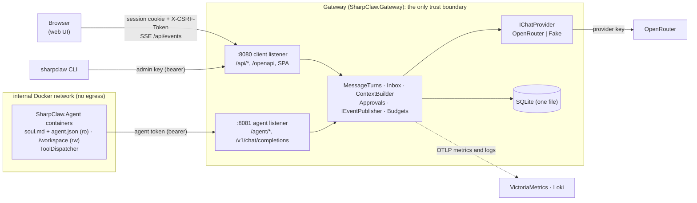
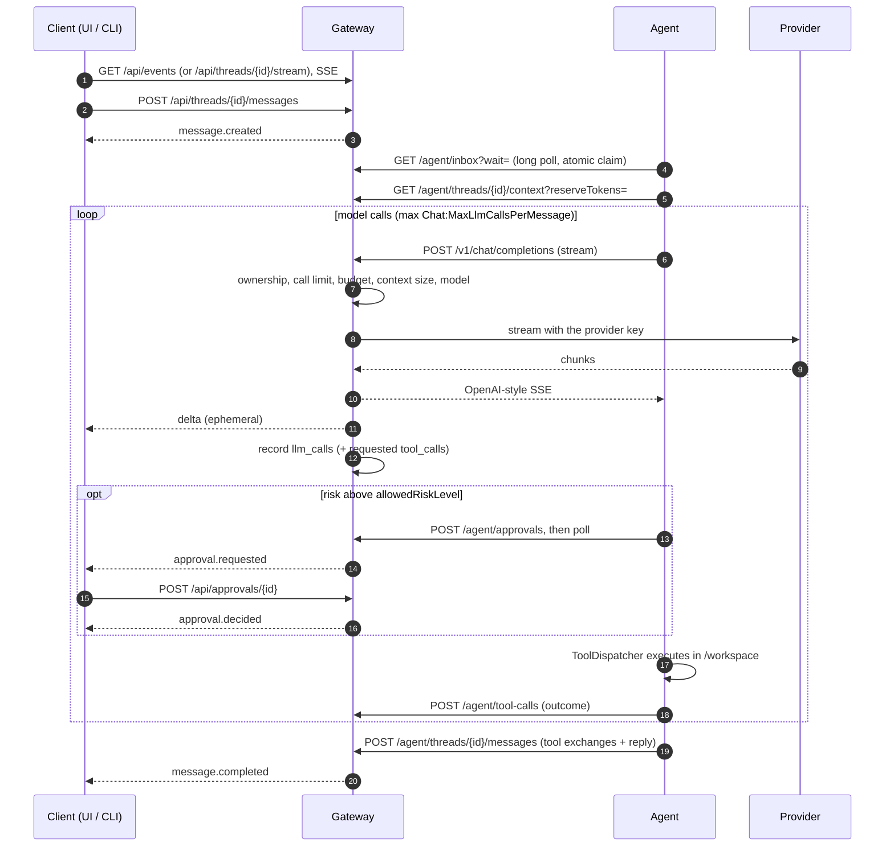

# SharpClaw — Architecture (current system)

This page describes the system **as it is now**. It is the first thing to read. The phase specs
([3.1](sharpclaw-3.1-implementation-spec.md) → [3.2](sharpclaw-3.2-implementation-spec.md) →
[pre-3.3 foundations](sharpclaw-pre-3.3-foundations-spec.md) → [3.3](sharpclaw-3.3-implementation-spec.md) →
[3.3.1](sharpclaw-3.3.1-ui-redesign-spec.md), plus the [agent tools spec](sharpclaw-agent-tools-spec.md))
record *why* and *when* each behaviour was decided; they remain the source of truth for detailed
behaviour, with later specs winning. Keep this page in step with the code when structure changes.

## 1. Components

| Project | Role |
|---|---|
| `src/SharpClaw.Contracts` | Wire shapes shared by everything: DTOs, SSE payloads, `ErrorCodes`, status/role constants, `SharpClawJson`. |
| `src/SharpClaw.Gateway` | The **only trust boundary**. Holds provider keys, budgets, auth, the message queue, approvals, events, audit and the UI files. |
| `src/SharpClaw.Agent` | Untrusted worker. Long-polls its inbox, builds the prompt from the gateway's context endpoint, calls the model **through the gateway**, runs workspace tools via `ToolDispatcher`. |
| `src/SharpClaw.Cli` | `sharpclaw` admin/chat CLI over the client API. |
| `ui/` | React web UI, built into the gateway image and served same-origin. See [ui.md](ui.md). |

## 2. Listeners and authentication

One process, two Kestrel listeners. `ListenerFilter` separates route groups by the connection's
**local port** (never the `Host` header); a route on the wrong listener returns `404`.

| Listener | Routes | Credentials |
|---|---|---|
| Client `:8080` | `/api/*`, `/openapi/v1.json`, `/healthz`, the SPA | Admin key (bearer) **or** session cookie. Cookie-authenticated unsafe methods also need a same-origin `Origin`/`Referer` and `X-CSRF-Token`. `/api/users*` is admin-key only; logout and password change are session-only. |
| Agent `:8081` | `/agent/*`, `/v1/chat/completions`, `/healthz` | Agent token (bearer), stored as SHA-256 hex + 8-char prefix. Disabled agent → `403 agent_disabled`. |

**Browser login.** `POST /api/auth/login` with a username and password (PBKDF2-SHA256, 600,000
iterations, upgraded on login; at least 12 characters) sets an `HttpOnly`, `SameSite=Strict`
session cookie and returns a CSRF token. Cookie-authenticated `POST`/`PUT`/`PATCH`/`DELETE` need a
same-origin `Origin` (or `Referer`) and `X-CSRF-Token`, otherwise `403 csrf_failed`. Failed logins
are rate-limited per username and per IP, in memory (`429 rate_limited`). Sessions slide (7 days
idle, 30 days absolute) and are pruned daily. Users are created with the admin key
(`sharpclaw users create`). There is no CORS. TLS, when used, is terminated by a reverse proxy: set
`Auth:ForwardedHeaders:*` so the gateway trusts its forwarded headers, and `Auth:AllowedOrigins` if
the browser's origin differs from what the gateway sees.

## 3. Request flow of one turn

1. **Post.** The client posts to `POST /api/threads/{id}/messages`. The gateway stores a `pending`
   user message (with `seq`), emits `message.created` and signals the agent's inbox.
2. **Claim.** The agent's `GET /agent/inbox?wait=` long poll atomically claims the oldest pending
   message (`claimed`). A claim older than `Inbox:ClaimTimeoutSeconds` is requeued; chat calls,
   approval creation and approval polls refresh it (heartbeat).
3. **Context.** The agent fetches `GET /agent/threads/{id}/context?reserveTokens=`. The gateway
   returns the whole turns that fit the window, newest first (`ContextBuilder`, which reads only the
   newest turns it needs, not the whole thread), and records `droppedTurns`/`estimatedTokens` on the thread.
4. **Model calls.** `POST /v1/chat/completions` (streaming only). The gateway checks ownership, the
   per-message call limit, the daily budget and the context size, resolves the model (the thread's
   override while it is still in `Models:Allowed`, else the agent's), then streams from the provider as
   OpenAI-style SSE. Deltas are teed to the thread (`delta`, plus `ActiveTurnBuffers` for
   `snapshot`). Every call is recorded in `llm_calls` (append-only) and requested tool calls in `tool_calls`.
5. **Tools.** For each tool call the agent's `ToolDispatcher` applies hardline rules → risk
   (smart-mode classifier for uncertain calls) → taint bump → approval if above `allowedRiskLevel`
   (`POST /agent/approvals` then poll; the human decides via `POST /api/approvals/{id}`) → execute →
   report (`POST /agent/tool-calls`).
6. **Finish.** `POST /agent/threads/{id}/messages` stores the tool exchanges plus the reply in one
   transaction and emits `message.completed`; or `POST /agent/messages/{id}/fail` emits `error`.
   Either way, pending approvals for the turn are expired.

**Budgets.** Each agent has a daily USD cap. Spend is the sum of `llm_calls.cost_usd` since the
start of the current UTC day; a call over the cap returns `429` with `Retry-After` and is recorded
as `rejected`. Budgets reset at UTC midnight.

**Context window.** The window is the agent's `contextWindowTokens` (default
`Context:DefaultWindowTokens`) minus the agent's reserve for its soul and tool schemas and
`Context:ReplyReserveTokens`. Whole turns that don't fit are dropped, oldest first, and replaced by a
note; tokens are estimated as characters / 4. A turn that alone doesn't fit, a chat request over the
window, or a provider context-length error fails the turn with `context_too_large`.

## 4. Client API (client listener)

All JSON is camelCase; errors use `{ "error": { "code", "message" } }`. Foreign or unknown ids return `404`.
The committed contract is [openapi/sharpclaw-client.v1.json](openapi/sharpclaw-client.v1.json).

| Area | Routes |
|---|---|
| auth | `POST /api/auth/login`, `GET /api/auth/session`, `POST /api/auth/logout`, `POST /api/auth/password` |
| users (admin key) | `GET/POST /api/users`, `PATCH /api/users/{name}`, `PUT /api/users/{name}/password` |
| agents, tokens | `GET/POST /api/agents`, `GET/PATCH /api/agents/{idOrName}`, `GET/POST /api/agents/{idOrName}/tokens`, `DELETE …/tokens/{tokenId}` |
| threads | `GET/POST /api/threads`, `GET/PATCH /api/threads/{id}`, `GET /api/threads/{id}/trace` |
| messages | `GET/POST /api/threads/{id}/messages` (seq paging), `GET /api/threads/{id}/stream` (SSE) |
| events | `GET /api/events` (global SSE stream) |
| approvals | `GET /api/approvals`, `GET /api/approvals/{id}`, `POST /api/approvals/{id}` (decide) |
| audit | `GET /api/audit/llm-calls`, `GET /api/audit/tool-calls` (keyset cursors) |
| system | `GET /api/system` (version, provider, clock, `models` allow-list) |
| dashboard (3.3.1) | `GET /api/usage?range=today\|7d\|30d&agent=` (zero-filled UTC buckets, by model, by agent), `GET /api/activity` (recent prompts and replies across threads), `GET /api/credits` (cached OpenRouter balance) |

Agent listener: `GET /agent/inbox`, `GET /agent/threads/{id}/messages`,
`GET /agent/threads/{id}/context`, `POST /agent/threads/{id}/messages`, `POST /agent/messages/{id}/fail`,
`POST /agent/approvals`, `GET /agent/approvals/{id}`, `POST /agent/tool-calls`, `POST /v1/chat/completions`.

## 5. Events

`IEventPublisher` is the single path for client events.

- **Durable** events are staged by `IEventPublisher.WriteAsync` in the **same transaction** as the
  state change they describe (`thread_events`, row id = SSE `id`), then published on the in-memory
  `ThreadEventBus` after commit. Event-producing writes are serialised, so ids reach subscribers in
  order; a failed write publishes nothing.
- Each subscriber has a bounded buffer (`Events:SubscriberBufferSize`); a subscriber that falls
  behind is disconnected and recovers by reconnecting with `Last-Event-ID`.
- **`delta`** is ephemeral (bus only).
- A stream subscribes **before** computing its replay baseline. It replays `id > Last-Event-ID`,
  sends `ready` (id = baseline), then a `snapshot` per in-flight turn, then live events. Replayed ids
  and deltas already covered by a snapshot are dropped.
- If `Last-Event-ID` predates retention (`Events:RetentionDays`), the stream sends `reset`.
- Never put tool arguments or results in an event.

Payloads and their samples: [ui.md § Live events](ui.md#live-events), `docs/api-fixtures/events/`.

## 6. Data (SQLite, snake_case)

| Table | Purpose |
|---|---|
| `agents`, `agent_tokens` | Agent config (model, daily budget, context window, enabled, last seen); hashed tokens. |
| `threads` | Owner agent, title, archived, `last_message_at`/`last_preview`, last context figures, optional `model` override (must be in `Models:Allowed` to take effect). |
| `messages` | User messages, final replies and tool exchange rows (`kind`), ordered by per-thread `seq`; user rows carry the queue state (`pending → claimed → done/failed`) and `sent_by_user` (user name or `admin_key`). |
| `llm_calls` | Append-only audit of every model call (tokens, cost, latency, purpose, outcome). |
| `tool_calls` | Every tool call the model requested, plus the agent's report. |
| `approvals` | Approval requests and decisions (`decided_by` = user/system; `decided_by_user` = which user, or `admin_key`). |
| `thread_events`, `event_log_state` | Durable SSE events and the retention watermark. |
| `users`, `sessions` | Browser users (PBKDF2 passwords) and hashed session tokens with CSRF tokens. |

IDs are `Guid.CreateVersion7()`; timestamps are UTC `DateTime`; money is `double` USD. Schema
changes go through EF migrations in `src/SharpClaw.Gateway/Data/Migrations`.

## 7. Gateway code map

| Folder | Contents |
|---|---|
| `GatewayBuilder.cs` | Composition root: `AddSharpClawOptions()` (bound **and validated**; bad config stops startup), JSON (`SharpClawJson.Apply`), DbContext, Kestrel listeners, middleware, `MapSharpClawEndpoints()`. |
| `Configuration/` | Options classes (DataAnnotations) and `OptionsRegistration` (source-generated validators plus cross-field rules, `IStartupCheck`). |
| `Auth/` | Client and agent auth filters, sessions, login rate limiter, password hashing, auth/user endpoints. |
| `Endpoints/` | Minimal-API endpoint classes per area: thin HTTP adapters (validate input, call a service, map the outcome to a result). |
| `Services/` | `MessageTurns` (post/complete/fail/release of a turn) and `TurnGuard` (the one agent-ownership rule); inbox, message queries, context building, events (publisher, bus, turn buffers), approvals, background services. |
| `Services/Chat/` | Chat-completion helpers: request parsing, OpenAI-style chunk writing, `llm_calls` recording. |
| `Providers/` | `IChatProvider` with `OpenRouterProvider` and the scripted `FakeProvider`. |
| `Telemetry/` | `GatewayMetrics` (meter `SharpClaw.Gateway`) and OTLP wiring. |
| `Infrastructure/` | Listener filter, error results, exception middleware, OpenAPI, UI hosting, paging cursor, `LogScopes`; `Sse/EventStreamResult` (replay + live SSE). |

## 8. Invariants (each guarded by tests)

- Listener separation is by local port; the wrong listener returns `404` (`HealthAndListenerTests`).
- Only `ToolDispatcher` may call `IAgentTool.ExecuteUncheckedAsync` (`ToolArchitectureTests`).
- No agent tool executes code or shell commands. Tool policy is read only from read-only config,
  never from the workspace.
- No prompt or reply content, soul, tool arguments or results, tokens, keys, passwords or cookies
  in logs, metric labels or events (`PrivacyTests` and others).
- Metric labels are limited to agent, model, status, type and listener; never ids.
- The client contract (OpenAPI + event fixtures) changes only deliberately (`SnapshotTests`, `npm run check:api`).
- Product code takes time from an injected `TimeProvider`.

## 9. Operations

Docker Compose runs from an install directory outside the repo (default `~/sharpclaw`), created by
`scripts/install.sh` from [docker/template/](../docker/template/) and running images built by
`scripts/build-images.sh`; `scripts/quickstart.sh` asks for the location, provider and agent names, does both, adds a compose
service per agent, then creates the agents, their tokens and the first user through the client API. `scripts/dev-stack.sh` runs a throwaway fake-provider
stack on port 8090 for development. The gateway publishes only the client port
(`${CLIENT_BIND:-127.0.0.1}:${CLIENT_PORT:-8080}`) and keeps SQLite in the install's `data/`.
Agents run read-only on an internal network with no egress; check this with `scripts/verify-isolation.sh`.
Telemetry: [telemetry-notes.md](telemetry-notes.md). Known and accepted debt: [tech-debt.md](tech-debt.md).
