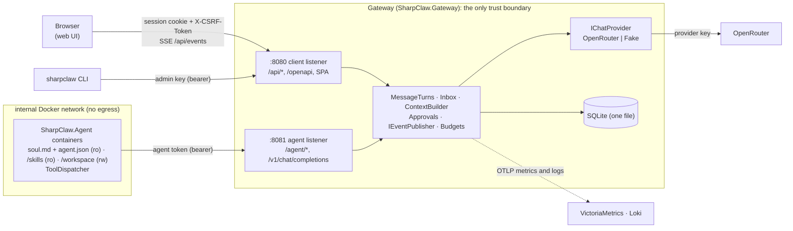
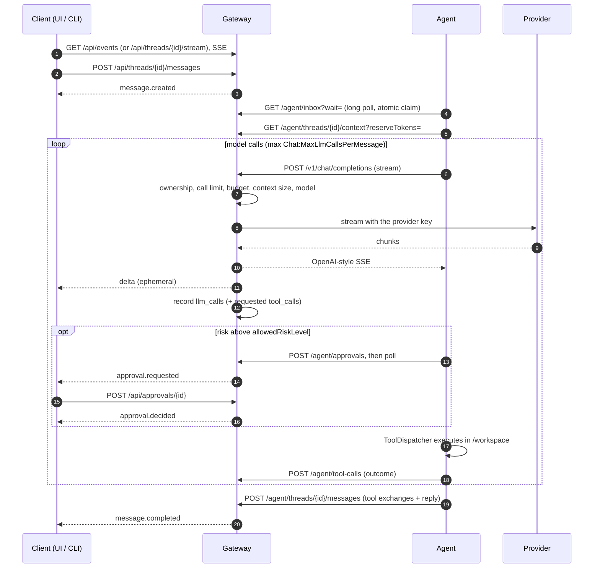
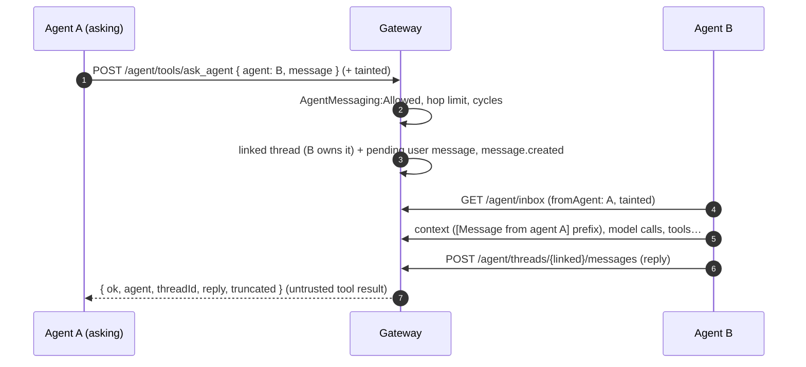

# SharpClaw — Architecture (current system)

This page describes the system **as it is now**. It is the first thing to read. The phase specs
([3.1](sharpclaw-3.1-implementation-spec.md) → [3.2](sharpclaw-3.2-implementation-spec.md) →
[pre-3.3 foundations](sharpclaw-pre-3.3-foundations-spec.md) → [3.3](sharpclaw-3.3-implementation-spec.md) →
[3.3.1](sharpclaw-3.3.1-ui-redesign-spec.md), plus the [agent tools spec](sharpclaw-agent-tools-spec.md),
the [external tools spec](sharpclaw-external-tools-spec.md) and the
[skills spec](sharpclaw-skills-spec.md), and [3.5](sharpclaw-3.5-implementation-spec.md),
agent-to-agent messaging)
record *why* and *when* each behaviour was decided; they remain the source of truth for detailed
behaviour, with later specs winning. Keep this page in step with the code when structure changes.

## 1. Components

| Project | Role |
|---|---|
| `src/SharpClaw.Contracts` | Wire shapes shared by everything: DTOs, SSE payloads, `ErrorCodes`, status/role constants, `SharpClawJson`. |
| `src/SharpClaw.Gateway` | The **only trust boundary**. Holds provider keys, budgets, auth, the message queue, approvals, events, audit and the UI files. |
| `src/SharpClaw.Agent` | Untrusted worker. Long-polls its inbox, builds the prompt from the gateway's context endpoint, calls the model **through the gateway**, runs workspace tools via `ToolDispatcher`. With `skill_read` enabled it loads the operator's skill library (see below). |
| `src/SharpClaw.Sandbox` | The per-agent sandbox runner (`sandbox-<agent>`, image `sharpclaw-sandbox`): runs broker tools that parse untrusted input or run code, against that agent's workspace only. Accepts calls from the gateway only (service secret); its only route out is the gateway's egress proxy. Shares the agent's `WorkspaceRoot`/`NoFollow` path rules by source. |
| `src/SharpClaw.Cli` | `sharpclaw` admin/chat CLI over the client API. |
| `ui/` | React web UI, built into the gateway image and served same-origin. See [ui.md](ui.md). |

## 2. Listeners and authentication

One process, two Kestrel listeners (three with sandboxes). `ListenerFilter` separates route groups
by the connection's **local port** (never the `Host` header); a route on the wrong listener returns
`404`.

| Listener | Routes | Credentials |
|---|---|---|
| Client `:8080` | `/api/*`, `/openapi/v1.json`, `/healthz`, the SPA | Admin key (bearer) **or** session cookie. Cookie-authenticated unsafe methods also need a same-origin `Origin`/`Referer` and `X-CSRF-Token`. `/api/users*` is admin-key only; logout and password change are session-only. |
| Agent `:8081` | `/agent/*`, `/v1/chat/completions`, `/healthz` | Agent token (bearer), stored as SHA-256 hex + 8-char prefix. Disabled agent → `403 agent_disabled`. |
| Egress `:8082` (only when `Egress:Sandboxes` is set; never published) | None: a raw connection handler (`EgressConnectionHandler`), not HTTP routing. Accepts `CONNECT host:443` and absolute-form `http://host[:80]/…` only. | Per-sandbox proxy credential (`Proxy-Authorization: Basic sbx-<name>:<secret>`); otherwise `407`. |

**Egress proxy** ([external tools spec](sharpclaw-external-tools-spec.md) section 5). The sandboxes'
only route out. It reads one request head (64 KB, 30 s), refuses anything but the two forms above,
checks the credential, the port and `Egress:DenyHosts`, resolves the host once and refuses if
**any** address is loopback, private, link-local, CGNAT, multicast, reserved or an IPv6 form of
those (`EgressAddressPolicy`), then connects to that checked address. TLS tunnels are never parsed;
plain HTTP is rewritten to origin form (proxy and hop-by-hop headers removed, `Connection: close`),
one request per connection. Per sandbox: 32 connections, 60 s idle, 1 GB per connection. Each
connection is logged (agent, host, port, method, decision, bytes, duration; never paths, queries or
headers) and counted in `sharpclaw.egress.connections` / `sharpclaw.egress.bytes`.

**Browser login.** `POST /api/auth/login` with a username and password (PBKDF2-SHA256, 600,000
iterations, upgraded on login; at least 12 characters) sets an `HttpOnly`, `SameSite=Strict`
session cookie and returns a CSRF token. Cookie-authenticated `POST`/`PUT`/`PATCH`/`DELETE` need a
same-origin `Origin` (or `Referer`) and `X-CSRF-Token`, otherwise `403 csrf_failed`. Failed logins
are rate-limited per username and per IP, in memory (`429 rate_limited`). Sessions slide (7 days
idle, 30 days absolute) and are pruned daily. Users are created with the admin key
(`sharpclaw users create`). There is no CORS. TLS, when used, is terminated by a reverse proxy: set
`Auth:ForwardedHeaders:*` so the gateway trusts its forwarded headers, and `Auth:AllowedOrigins` if
the browser's origin differs from what the gateway sees.

## 3. Request flow of one turn

1. **Post.** The client posts to `POST /api/threads/{id}/messages`. The gateway stores a `pending`
   user message (with `seq`), emits `message.created` and signals the agent's inbox.
2. **Claim.** The agent's `GET /agent/inbox?wait=` long poll atomically claims the oldest pending
   message (`claimed`). A claim older than `Inbox:ClaimTimeoutSeconds` is requeued; chat calls,
   approval creation and approval polls refresh it (heartbeat).
3. **Context.** The agent fetches `GET /agent/threads/{id}/context?reserveTokens=`. The gateway
   returns the whole turns that fit the window, newest first (`ContextBuilder`, which reads only the
   newest turns it needs, not the whole thread), and records `droppedTurns`/`estimatedTokens` on the thread.
4. **Model calls.** `POST /v1/chat/completions` (streaming only). The gateway checks ownership, the
   per-message call limit, the daily budget and the context size, resolves the model (the thread's
   override while it is still in `Models:Allowed`, else the agent's), then streams from the provider as
   OpenAI-style SSE. Deltas are teed to the thread (`delta`, plus `ActiveTurnBuffers` for
   `snapshot`). Every call is recorded in `llm_calls` (append-only) and requested tool calls in `tool_calls`.
5. **Tools.** For each tool call the agent's `ToolDispatcher` applies hardline rules → risk
   (smart-mode classifier for uncertain calls; it sees a tool's structured fields when it has them,
   never model-supplied free text) → taint bump → approval if above `allowedRiskLevel`, or always
   for an always-approve tool (`POST /agent/approvals` then poll; the human decides via
   `POST /api/approvals/{id}`) → execute → report (`POST /agent/tool-calls`). Workspace file I/O
   opens every path component without following symbolic links (`NoFollow`).
6. **Finish.** `POST /agent/threads/{id}/messages` stores the tool exchanges plus the reply in one
   transaction and emits `message.completed`; or `POST /agent/messages/{id}/fail` emits `error`.
   Either way, pending approvals for the turn are expired.

**Agent to agent** ([3.5 spec](sharpclaw-3.5-implementation-spec.md)). An agent asks another with
the `ask_agent` broker tool (`AskAgentToolHandler` → `AgentAsks`), inside a turn it holds:

The pair must be in `AgentMessaging:Allowed:<sender>` (not allowed and unknown both answer `404`)
and the recipient enabled. The question is a `user` row in a thread the recipient owns, one per
(originating thread, sender, recipient), with `sender_agent_id`, `origin_message_id`,
`origin_tool_call_id` (unique together: a retried call waits on the same ask), `hop` and
`origin_tainted`; it copies `unattended` from the asking message. The gateway refuses chains longer
than `MaxHops`, a recipient already in the chain, and two agents asking each other from separate
chains. While it waits it refreshes the asker's claim; on `AskTimeoutSeconds`, a dropped request or
the asking turn ending, a still-`pending` question is failed (`ask_timeout`/`ask_cancelled`, `error`
event), while one the recipient has claimed runs to completion. The asker's reply taints its turn;
a question from a tainted turn starts the recipient's turn tainted.

**Budgets.** Each agent has a daily USD cap. Spend is the sum of `llm_calls.cost_usd` since the
start of the current UTC day; a call over the cap returns `429` with `Retry-After` and is recorded
as `rejected`. Budgets reset at UTC midnight.

**Context window.** The window is the agent's `contextWindowTokens` (default
`Context:DefaultWindowTokens`) minus the agent's reserve for its system message (soul plus skill index) and tool schemas and
`Context:ReplyReserveTokens`. Whole turns that don't fit are dropped, oldest first, and replaced by a
note; tokens are estimated as characters / 4. A turn that alone doesn't fit, a chat request over the
window, or a provider context-length error fails the turn with `context_too_large`. Within a turn
the agent's `TurnBudget` keeps its own tool traffic inside the window: before each call after the
first it estimates the request exactly as the gateway does and replaces the turn's oldest tool
results with a stub (naming the saved copy in the workspace, if any) until it fits; if it still
doesn't, or the gateway rejects a later call anyway, the turn fails with `turn_too_large`.

## 4. Client API (client listener)

All JSON is camelCase; errors use `{ "error": { "code", "message" } }`. Foreign or unknown ids return `404`.
The committed contract is [contracts/openapi/sharpclaw-client.v1.json](../contracts/openapi/sharpclaw-client.v1.json).

| Area | Routes |
|---|---|
| auth | `POST /api/auth/login`, `GET /api/auth/session`, `POST /api/auth/logout`, `POST /api/auth/password` |
| users (admin key) | `GET/POST /api/users`, `PATCH /api/users/{name}`, `PUT /api/users/{name}/password` |
| agents, tokens | `GET/POST /api/agents`, `GET/PATCH /api/agents/{idOrName}`, `GET/POST /api/agents/{idOrName}/tokens`, `DELETE …/tokens/{tokenId}` |
| threads | `GET/POST /api/threads`, `GET/PATCH /api/threads/{id}`, `GET /api/threads/{id}/trace` |
| messages | `GET/POST /api/threads/{id}/messages` (seq paging), `GET /api/threads/{id}/stream` (SSE) |
| events | `GET /api/events` (global SSE stream) |
| approvals | `GET /api/approvals`, `GET /api/approvals/{id}` (adds `detail` for broker calls: a command, capped at 1,000 chars), `POST /api/approvals/{id}` (decide) |
| audit | `GET /api/audit/llm-calls`, `GET /api/audit/tool-calls` (keyset cursors) |
| system | `GET /api/system` (version, provider, clock, `models` allow-list) |
| dashboard (3.3.1) | `GET /api/usage?range=today\|7d\|30d&agent=` (zero-filled UTC buckets, by model, by agent), `GET /api/activity` (recent prompts and replies across threads), `GET /api/credits` (cached OpenRouter balance) |

Agent listener: `GET /agent/inbox`, `GET /agent/threads/{id}/messages`,
`GET /agent/threads/{id}/context`, `POST /agent/threads/{id}/messages`, `POST /agent/messages/{id}/fail`,
`POST /agent/approvals`, `GET /agent/approvals/{id}`, `POST /agent/tool-calls`, `POST /agent/tools/{tool}`,
`PUT /agent/skills`, `GET /agent/tools`, `POST /v1/chat/completions`. `ask_agent` is a broker tool
(`POST /agent/tools/ask_agent`).

**Skills** ([skills spec](sharpclaw-skills-spec.md)). The operator's skill library is a host folder
bind-mounted read-only at `/skills` in every agent (never under `/workspace`). An agent with
`skill_read` in its `agent.json` scans it once at startup (`SkillLibrary`: a hand-written
frontmatter reader for `name`/`description` only, invalid skills skipped with a warning, at most 100
skills and a 16 KB index), appends the index (one line per skill) to its system message, and loads
skill files on demand with `skill_read` (low risk, not untrusted, workspace path rules rooted at the
skill). Skills never grant tools or change policy. At startup it reports the loaded names and
descriptions with `PUT /agent/skills`, which the gateway validates with the same `SkillRules`
(Contracts), stores in `agent_skills` (replace-all, one transaction) and returns as
`AgentDto.skills`/`skillsReportedAt`. No event: the list only changes when an agent restarts.

**Tool broker** (`POST /agent/tools/{tool}`, [external tools spec](sharpclaw-external-tools-spec.md)
section 4): runs a broker tool for the agent, inside a turn it holds. The tool must be enabled for
the agent in gateway config (`ToolBroker:Agents:<name>:Tools`, or every broker tool when
`ToolBroker:Agents:<name>:AllTools` is `true`; otherwise `404`). Tools in
`ToolBroker:AlwaysApprove` (default `sandbox_run`, `github_write`, `github_create_pr`) need an
`approvalId` that is this agent's, for this turn and tool, approved within
`ToolBroker:ApprovalUseSeconds`, unused, and whose `args_hash` matches the SHA-256 of the canonical
arguments, which the gateway recomputes (`ToolArgsHash`); it is consumed by the same conditional
update that checks it (otherwise `403 approval_required`). The call goes to the tool's
`IBrokerToolHandler` (none → `503 tool_unavailable`), anything agent-specific such as the sandbox
comes from the agent's identity, and every call is recorded in `broker_calls`.
`web_search` runs in the gateway (`WebSearchToolHandler`): a separate non-streaming OpenRouter call
with the `web` plugin on `WebSearch:Model` (`IWebSearchProvider`; `FakeWebSearch` answers from
fake-script `citations` rules), reduced to `{ title, url, excerpt }` results; it is recorded in
`llm_calls` with purpose `web_search` and counts against the daily budget. The server-side search
tool is never enabled on agent chat completions. Sandbox tools go to `SandboxToolHandler`, which
forwards to the calling agent's own runner.
GitHub tools run in the gateway (`GitHub/GitHubClient`): typed calls only, on two named clients
fixed to `https://api.github.com` that never follow redirects, one per token (`GitHub:Token` for
reads, writes and opening PRs; `GitHub:ForkToken` only for the machine user's forks). Operations are
a fixed enum, owner/repo names are validated and checked against the optional `GitHub:Repos`
allow-list before anything is sent (`403 repo_not_allowed`), and answers are parsed into typed DTOs
and reduced (64 KB). Broker results use relaxed JSON escaping (they never go into HTML).

`github_create_pr` (`PullRequestBuilder`): the gateway takes the clone's origin and base commit
from `sandbox_clones`, asks the agent's runner for the change set (`git_changes`, gateway-only),
and refuses outright (never offered for approval) anything off `GitHub:Repos`, touching
`GitHub:BlockedPaths` (default `.github/workflows/**`), containing links or submodules, over 100
files / 1 MB per file / 5 MB, or with a bad branch name. The approval's hash covers the arguments
**and** the change set, and its detail lists every file with line counts (never contents). The broker
asks the handler for that hash before consuming the approval (`IBrokerToolHandler.PrepareAsync`) and
uses the very same plan to build: with the fork token, a new ref `sharpclaw/<agent>/<branch>` in
`<ForkOwner>/<repo>` at the base (syncing the fork once if needed; an existing ref is refused, never
moved), blobs, a tree on the base tree, a commit, then a fast-forward of that new ref; with the
owner token, the PR from `<ForkOwner>:sharpclaw/<agent>/<branch>` to the upstream default branch.
The fork token is refused for any path outside `repos/<ForkOwner>/`.

## 5. Events

`IEventPublisher` is the single path for client events.

- **Durable** events are staged by `IEventPublisher.WriteAsync` in the **same transaction** as the
  state change they describe (`thread_events`, row id = SSE `id`), then published on the in-memory
  `ThreadEventBus` after commit. Event-producing writes are serialised, so ids reach subscribers in
  order; a failed write publishes nothing.
- Each subscriber has a bounded buffer (`Events:SubscriberBufferSize`); a subscriber that falls
  behind is disconnected and recovers by reconnecting with `Last-Event-ID`.
- **`delta`** is ephemeral (bus only).
- A stream subscribes **before** computing its replay baseline. It replays `id > Last-Event-ID`,
  sends `ready` (id = baseline), then a `snapshot` per in-flight turn, then live events. Replayed ids
  and deltas already covered by a snapshot are dropped.
- If `Last-Event-ID` predates retention (`Events:RetentionDays`), the stream sends `reset`.
- Never put tool arguments or results in an event.

Payloads and their samples: [ui.md § Live events](ui.md#live-events), [contracts/events/](../contracts/events/).

## 6. Data (SQLite, snake_case)

| Table | Purpose |
|---|---|
| `agents`, `agent_tokens` | Agent config (model, daily budget, context window, enabled, last seen, `skills_reported_at`); hashed tokens. |
| `agent_skills` | The skills each agent last reported (`agent_id`, `name`, `description`); replaced as a whole by `PUT /agent/skills`, deleted with the agent. |
| `threads` | Owner agent, title, archived, `last_message_at`/`last_preview`, last context figures, optional `model` override (must be in `Models:Allowed` to take effect); on linked threads, `origin_thread_id`/`origin_agent_id` (the asking agent's thread). |
| `messages` | User messages, final replies and tool exchange rows (`kind`), ordered by per-thread `seq`; user rows carry the queue state (`pending → claimed → done/failed`) and `sent_by_user` (user name or `admin_key`), or for agent asks `sender_agent_id`, `origin_message_id`/`origin_tool_call_id`, `hop` and `origin_tainted`. |
| `llm_calls` | Append-only audit of every model call (tokens, cost, latency, purpose `chat`/`risk_assessment`/`web_search`, outcome). |
| `tool_calls` | Every tool call the model requested, plus the agent's report. |
| `approvals` | Approval requests and decisions (`decided_by` = user/system; `decided_by_user` = which user, or `admin_key`); `args_hash` binds an approval to exact arguments, `used_at` marks it consumed by the broker. |
| `sandbox_clones` | Where each agent's sandbox clone came from (host, `owner/repo`, base commit), written by the gateway from the runner's answer to `git_clone`; `github_create_pr` trusts only this. |
| `broker_calls` | Append-only audit of every tool-broker call: agent, turn, tool, target host or repository, status, bytes, duration, approval. Never arguments or results. |
| `thread_events`, `event_log_state` | Durable SSE events and the retention watermark. |
| `users`, `sessions` | Browser users (PBKDF2 passwords) and hashed session tokens with CSRF tokens. |

IDs are `Guid.CreateVersion7()`; timestamps are UTC `DateTime`; money is `double` USD. Schema
changes go through EF migrations in `src/SharpClaw.Gateway/Data/Migrations`.

## 7. Gateway code map

| Folder | Contents |
|---|---|
| `GatewayBuilder.cs` | Composition root: `AddSharpClawOptions()` (bound **and validated**; bad config stops startup), JSON (`SharpClawJson.Apply`), DbContext, Kestrel listeners, middleware, `MapSharpClawEndpoints()`. |
| `Configuration/` | Options classes (DataAnnotations) and `OptionsRegistration` (source-generated validators plus cross-field rules, `IStartupCheck`). |
| `Auth/` | Client and agent auth filters, sessions, login rate limiter, password hashing, auth/user endpoints. |
| `Endpoints/` | Minimal-API endpoint classes per area: thin HTTP adapters (validate input, call a service, map the outcome to a result). |
| `Services/Broker/` | `ToolBroker` (gateway-enforced approval, routing, response cap, `broker_calls`) and `IBrokerToolHandler`, one per broker tool. |
| `Services/` | `MessageTurns` (post/complete/fail/release of a turn) and `TurnGuard` (the one agent-ownership rule); inbox, message queries, context building, events (publisher, bus, turn buffers), approvals, background services. |
| `Services/Chat/` | Chat-completion helpers: request parsing, OpenAI-style chunk writing, `llm_calls` recording. |
| `Providers/` | `IChatProvider` with `OpenRouterProvider` and the scripted `FakeProvider`. |
| `Telemetry/` | `GatewayMetrics` (meter `SharpClaw.Gateway`) and OTLP wiring. |
| `Egress/` | The egress proxy: `EgressConnectionHandler`, `ProxyRequestHead` (strict head parser), `EgressAddressPolicy`, and the `IEgressResolver`/`IEgressConnector` seams. |
| `Infrastructure/` | Listener filter, error results, exception middleware, OpenAPI, UI hosting, paging cursor, `LogScopes`; `Sse/EventStreamResult` (replay + live SSE). |

## 8. Invariants (each guarded by tests)

- Listener separation is by local port; the wrong listener returns `404` (`HealthAndListenerTests`).
- The egress listener runs no HTTP routes, refuses private and reserved destinations after
  resolution, and connects only to the address it checked (`EgressProxyTests`, `EgressAddressPolicyTests`).
- Only `ToolDispatcher` may call `IAgentTool.ExecuteUncheckedAsync` (`ToolArchitectureTests`).
- Workspace tools never follow a symbolic link, even one created after the path was checked
  (`WorkspaceToolsTests.NoFollow`); `skill_read` applies the same rules inside a skill
  (`SkillReadToolTests`).
- Skills come only from the read-only `/skills` mount, can't grant tools or change policy (fields
  other than `name` and `description` are ignored), and an invalid one never stops the agent
  (`SkillLibraryTests`, `SkillFrontmatterTests`; `verify-isolation.sh` checks the mount).
- No agent tool executes code or shell commands inside the agent. Code runs only as `sandbox_run`
  in the agent's own sandbox, behind a gateway-enforced approval whose detail shows the human the
  command (`SandboxRunTests`); lists, events, logs and the classifier see only its length and folder.
  Tool policy is read only from read-only config,
  never from the workspace.
- No prompt or reply content, soul, tool arguments or results, tokens, keys, passwords or cookies
  in logs, metric labels or events (`PrivacyTests` and others).
- Metric labels are limited to agent, model, status, type and listener; never ids.
- Agents never talk to each other directly: an ask goes only through `POST /agent/tools/ask_agent`,
  only for pairs in gateway config, never in a cycle or past `MaxHops`, and its reply is untrusted
  for the asker (`AgentAskTests`, `AskAgentToolTests`).
- The client contract (OpenAPI + event fixtures) changes only deliberately (`SnapshotTests`, `npm run check:api`).
- Product code takes time from an injected `TimeProvider`.

## 9. Sandboxes

Optional, per agent ([external tools spec](sharpclaw-external-tools-spec.md) sections 3 and 6). A
`sandbox-<name>` service (compose profile `sandboxes`) runs the runner and the .NET, Node and Python
toolchains, as the install's user, read-only root, `cap_drop: ALL`, `no-new-privileges`, 2 CPUs,
2 GB, 256 processes. It sits only on its own `sbx-<name>` network (`internal: true`) with the
gateway, mounts only its agent's workspace (rw), a per-agent cache volume and the skill library
(`/skills`, ro, so skill scripts can run through `sandbox_run`), and reaches the
internet only through the egress proxy with its own credential. The gateway calls it at
`ToolBroker:Agents:<name>:SandboxUrl` with `SANDBOX_<NAME>_SECRET`; the runner makes itself
non-dumpable and starts every child (argv only, through `setsid`) with an allow-listed environment
that never contains that secret, killing the child's whole process group on timeout or completion.

## 9. Operations

Docker Compose runs from an install directory outside the repo (default `~/sharpclaw`), created by
`scripts/install.sh` from [docker/template/](../docker/template/) and running images built by
`scripts/build-images.sh`; `scripts/quickstart.sh` asks for the location, provider and agent names, does both, adds a compose
service and a sandbox (with `AllTools`) per agent, then creates the agents, their tokens and the first user through the client API. `scripts/dev-stack.sh` runs a throwaway fake-provider
stack on port 8090 for development. The gateway publishes only the client port
(`${CLIENT_BIND:-127.0.0.1}:${CLIENT_PORT:-8080}`) and keeps SQLite in the install's `data/`.
Agents run read-only on an internal network with no egress; check this with `scripts/verify-isolation.sh`.
Telemetry: [telemetry-notes.md](telemetry-notes.md). Known and accepted debt: [tech-debt.md](tech-debt.md).
