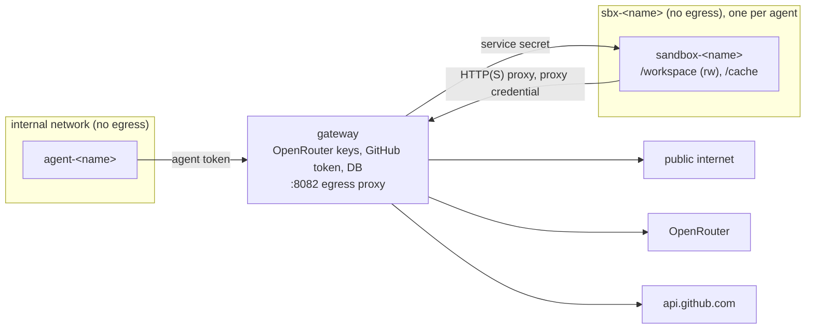

# SharpClaw V3 — External Tools Spec (network, GitHub, sandboxed code)

**Audience:** an implementing coding agent (and the human reviewing its work).
**Status:** **draft**. Not ready to implement until the open questions in section 0.2 are answered.
**Scope:** the first agent tools that reach beyond the agent's own workspace: fetching from the
web, web search, the GitHub API, cloning public repositories, extracting text from HTML and PDF,
and running code. This is a **deliberate change to the trust model**: it replaces section 6 ("Ruled
out") of the [agent tools spec](sharpclaw-agent-tools-spec.md) and the deferred network-tool design
in [3.2](sharpclaw-3.2-implementation-spec.md) §6. Everything else in 3.2 (risk model, agent
configuration, single dispatch path) still applies.

## 0. How to use this document

- Implement in the task order in section 11. Each task is one branch and one pull request with
  passing tests before the next starts.
- "MUST" / "MUST NOT" are hard requirements. If something is ambiguous, stop and ask.
- Never log or emit as a metric label any prompt, reply, tool argument, tool result, fetched
  content, command line, soul contents, token or key.

### 0.1 Decisions already made

- **Topology:** one **`sandbox-<agent>`** per agent runs code and parses untrusted input, and holds
  no secrets. Its only route to the internet is an **egress proxy built into the gateway** (section
  5): a separate listener, not a separate container. So every outbound byte still passes through
  the gateway. Credentials and code execution MUST NOT share a container.
- **Placement rule:** a tool that needs a credential runs in the **gateway**, as fixed, typed calls
  to a fixed host. That is how the gateway already uses OpenRouter, and it is already where the
  secrets live. A tool that runs or parses untrusted input runs in the agent's sandbox.
- **No separate credentials container.** A `toolhost` for credentialed APIs was considered and
  dropped. It would protect the GitHub token from a compromised gateway, which already holds more
  valuable keys, at the cost of an extra container, network, secret and hop. Revisit when there
  are many credentialed integrations (see [tech-debt](tech-debt.md)).
- **Web search** runs in the gateway through OpenRouter's web plugin, and **GitHub** runs in the
  gateway with a fine-grained token.
- **Sandbox egress while running code:** open internet over HTTPS and plain HTTP, with private,
  loopback, link-local and LAN addresses blocked by the gateway's egress proxy.
- **No separate egress container.** One was considered and dropped: the proxy is small, and the
  gateway is already on every sandbox network. The cost is that heavy sandbox traffic shares the
  gateway process; see the limits in section 5 and [tech-debt](tech-debt.md).
- **`git clone`:** public repositories only, over HTTPS, in this phase.
- **Sandbox toolchains:** .NET SDK, Node and Python.
- **No Docker socket**, anywhere. Sandboxes are long-lived compose services, not per-job containers.

### 0.2 Open questions (answer before implementing)

| # | Question | Proposed answer |
|---|---|---|
| Q1 | The approval prompt for `sandbox_run` is useless without the command, but summaries must never contain model-supplied text. | The approval **detail** (`GET /api/approvals/{id}`) shows the command, capped at 1,000 characters. The event, the list view, logs and the smart-mode classifier only ever see `run (412 chars) in repo/`. |
| Q2 | Which tools does the gateway always require an approval for, whatever the agent's `allowedRiskLevel`? | `sandbox_run` and every GitHub write. Configured in gateway options (`ToolBroker:AlwaysApprove`), never by the agent. |
| Q3 | `http_fetch` host policy: allow-list only, or open with approval for unknown hosts? | Open, matching sandbox egress. Hosts on an operator allow-list are `low`, others `medium`. |
| Q4 | GitHub write scope. | Comment on an issue or PR, create an issue, add or remove labels. No push, no PR creation, no merges, no repository settings. |
| Q5 | Do package caches persist between runs (NuGet, npm, pip)? | Yes, in a per-agent named volume mounted at `/cache`. It is never shared between agents. |
| Q6 | Sandbox limits. | 2 CPUs, 2 GB memory, 256 processes, 10 minutes per run (operator-configurable, capped at 30), 1 MB of combined stdout and stderr returned (the rest goes to a file in the workspace). |
| Q7 | Egress proxy limits. | 32 concurrent connections per sandbox, 60 s idle timeout, 30 s to complete the request head, 1 GB per connection, 64 KB maximum request head. |

## 1. Goal

Let agents do real developer work: read the web, search, read and comment on GitHub, clone a
repository, run its tests or build, and turn HTML or PDF into text. All of it stays behind the
gateway, keeps credentials away from untrusted code, and records every call.

## 2. Threat model

The model and anything it reads (web pages, repositories, issue text, PDFs) are **hostile**.
Prompt injection is assumed to succeed eventually. The design limits what a successful injection
can do:

| Asset | Where it lives | Protection |
|---|---|---|
| OpenRouter keys, GitHub token, admin key, DB | Gateway | No untrusted code and no rendering or conversion of untrusted content in the gateway. It parses only provider and GitHub JSON into typed DTOs, plus bounded proxy request heads (never tunnelled or body bytes). Each credential is used only by its own `HttpClient` with a fixed host. Nothing new can reach the gateway except through authenticated listeners. |
| Other agents' workspaces | Host bind mounts | Each sandbox mounts only its own agent's workspace and sits on its own network. |
| Home LAN, Docker networks, cloud metadata | Network | Sandboxes are on `internal: true` networks with no route out. Their only exit is the gateway's egress listener, which blocks private and reserved address ranges after DNS resolution. |
| Gateway availability | Gateway | Sandbox traffic shares the gateway process, so the egress proxy enforces per-sandbox connection, time and byte limits (Q7) and never buffers bodies. |
| Host | Docker | No Docker socket, `cap_drop: ALL`, `no-new-privileges`, non-root, read-only root filesystem, resource limits. |

**Accepted risk:** code running in a sandbox can read that agent's workspace and send it anywhere
on the public internet. Mitigations: approval for every run (Q2), one workspace per sandbox, and
the operator decides what goes into each agent's workspace. Record this in
[tech-debt.md](tech-debt.md).

## 3. Topology

- **Networks, one per sandbox so nothing can move sideways.** `internal` is unchanged: gateway and
  agents. Each sandbox gets its own `sbx-<name>` network (`internal: true`) holding only the gateway
  and that sandbox. Only the gateway is on `external`. So a sandbox can't reach another sandbox,
  and **agents are never on any of these networks**.
- **Gateway reachability.** All gateway listeners are reachable from each `sbx-<name>` network and
  from `internal` (Kestrel binds every interface). That is accepted, because every listener needs a
  credential: the client and agent listeners as today, and the egress listener a per-sandbox proxy
  credential (section 5). Agents don't have one, so they can't use the proxy.
  `verify-isolation.sh` checks all of this.
- **Services.** Each sandbox listens on one port and accepts only requests carrying its service
  secret (`SANDBOX_<NAME>_SECRET` in `.env`), compared in constant time.
- **Hardening (sandboxes):** read-only root, `tmpfs` for `/tmp`, `cap_drop: [ALL]`,
  `no-new-privileges`, non-root user, `restart: unless-stopped`, `pids_limit`, `mem_limit` and
  `cpus` (Q6).

## 4. The gateway tool broker

New agent-listener endpoint: `POST /agent/tools/{tool}` with the tool's arguments and, where
required, an `approvalId`.

1. Authenticate the agent token, as for every `/agent/*` route.
2. Check the tool is enabled for the agent **in gateway config** (`ToolBroker:Agents:<name>:Tools`).
   This is a second, operator-controlled gate. An agent can't call a broker tool its operator hasn't
   enabled, whatever its own `agent.json` says.
3. **Gateway-enforced approval.** For tools in `ToolBroker:AlwaysApprove` (Q2), the request MUST
   carry an `approvalId` that is: owned by this agent, `approved`, for this tool, not expired, not
   already used, and whose stored **arguments hash** (SHA-256 of the canonical JSON arguments)
   matches this request. The gateway marks it used in the same transaction. Otherwise `403
   approval_required`.
4. Route the call: web search and GitHub → handled in the gateway, everything else → the agent's own
   sandbox. **The sandbox is chosen from the agent's identity, never from the request.**
5. Record it in a new append-only `broker_calls` table (agent, tool, target host, status, bytes,
   duration, approval id) and in the existing metrics, with no content.
6. Return the downstream result, capped at the broker's response limit.

Approvals gain an `args_hash` column (new migration). The agent sends the hash when it creates the
approval, and the gateway recomputes it on the broker call. The agent never sends the hash to the
broker; the gateway always recomputes it.

On the agent side, each new tool is an `IAgentTool` whose `ExecuteUncheckedAsync` calls
`IGatewayClient.InvokeToolAsync`. Hardline rules, risk, taint, smart mode and approval all stay in
`ToolDispatcher`, exactly as today. The gateway check in step 3 is a second, independent gate, not a
replacement for the dispatcher.

## 5. Egress proxy (in the gateway)

A third Kestrel listener, `:8082`, that is **never published to the host**. It is wired with
`ListenOptions.UseConnectionHandler<EgressConnectionHandler>()`, so it is a raw TCP handler: no
ASP.NET Core routing, middleware, auth handlers or endpoints run on it, and the client and agent
route groups are unreachable through it. The sandboxes get
`HTTP_PROXY=HTTPS_PROXY=http://sbx-<name>:<secret>@gateway:8082` and `NO_PROXY=` (empty). They have
no other route out, so tools that ignore the proxy just fail.

**Request handling.** The handler reads one request head, at most 64 KB and within the head
timeout. It accepts exactly two forms and closes the connection with a fixed error response on
anything else:

- **`CONNECT host:443 HTTP/1.1`** (HTTPS). After the checks it replies `200 Connection Established`
  and copies bytes both ways. The tunnelled TLS stream is **never parsed**.
- **Absolute-form plain HTTP**, e.g. `GET http://host[:80]/path HTTP/1.1`, with any method. Port 80
  only. The handler rewrites the request line to origin form (`GET /path HTTP/1.1`), sets `Host`
  from the checked target, removes `Proxy-Authorization`, `Proxy-Connection` and the hop-by-hop
  headers, and forces `Connection: close`. It then writes the rewritten head to the checked IP and
  copies the rest (body and response) both ways without parsing. **One request per connection**, so
  a client can't switch to another host partway through a connection.

**Checks, for both forms, before any outbound connection:**

- **Proxy authentication.** `Proxy-Authorization: Basic` MUST match a configured sandbox credential
  (`Egress:Sandboxes:<name>:Secret`, compared in constant time). It identifies which agent the
  traffic belongs to. Missing or wrong → `407` and close. Agents have no credential.
- **Target address.** The handler resolves the host itself and rejects the request if **any**
  resolved address is loopback, private (RFC 1918), link-local (including `169.254.169.254`),
  CGNAT (`100.64.0.0/10`), multicast, unspecified, IPv6 ULA or link-local, or an IPv4-mapped form
  of any of those. It also rejects IP-literal hosts in those ranges. Then it **connects to the
  checked IP**, never re-resolving. This also blocks the gateway itself, other containers and the
  LAN.
- **Ports.** 443 for `CONNECT` and 80 for plain HTTP. No SOCKS and no other protocols, so `git://`
  and `ssh://` fail.
- **Operator deny-list** of hosts (optional).

**Limits (Q7), so a sandbox can't starve the gateway:** concurrent connections per sandbox, head
timeout, idle timeout, a byte cap per connection, and fixed-size copy buffers (bodies are never
buffered whole). Over a limit, the request is refused or the connection closed.

**Audit and telemetry.** Each connection is logged with agent, host, port, method (plain HTTP
only), decision, bytes in and out, and duration, with `agent` in the log scope. Never paths, query
strings, headers or bodies. Metrics `sharpclaw.egress.connections` (labels: agent, type
`connect`|`http`, status) and `sharpclaw.egress.bytes` (agent).

## 6. Sandbox (`sandbox-<agent>`)

- **Image** `sharpclaw-sandbox`: Debian with .NET SDK, Node LTS, Python 3, `git`, `pandoc`,
  `poppler-utils`, plus the runner. No compilers or tools beyond what the toolchains need.
- **Runner:** a small ASP.NET Core service (our C#) that accepts operations from the gateway only.
  Each operation starts a child process **with an argv array** (never a shell string, except inside
  `sandbox_run`), in its own process group, with a timeout. On timeout or completion the whole group
  is killed so nothing lingers between runs.
- **Mounts:** `./agents/<name>/workspace` → `/workspace` (rw), a named volume → `/cache` (Q5),
  nothing else. Runs as the same host UID as the agent so files stay editable.
- **Environment:** proxy variables (including the sandbox's proxy credential, which only lets it use
  egress as itself), `HOME=/tmp/home`, cache paths under `/cache`, `GIT_TERMINAL_PROMPT=0`,
  `DOTNET_CLI_TELEMETRY_OPTOUT=1`. No other secrets.

## 7. Tools

| Tool | Runs in | Arguments | Risk (agent) | Gateway approval | Untrusted result |
|---|---|---|---|---|---|
| `http_fetch` | sandbox | `url`, `format` (`markdown`\|`text`\|`raw`) | `low` allow-listed host, else `medium` (Q3) | no | **yes** |
| `download_to_workspace` | sandbox | `url`, `path`, `overwrite` | `medium`; sensitive path `Uncertain` | no | no (summary only) |
| `web_search` | gateway | `query`, `maxResults` (1–10) | `low` | no | **yes** |
| `extract_text` | sandbox | `path` (`.html`, `.htm`, `.pdf`), `to` | `low`; sensitive `to` `Uncertain` | no | no (writes a file) |
| `git_clone` | sandbox | `url` (public `https://`), `path` | `medium` | no | no |
| `sandbox_run` | sandbox | `command` (string), `cwd`, `timeoutSeconds` | `high` | **yes** | **yes** |
| `github_read` | gateway | `operation`, `owner`, `repo`, `number`… | `low` | no | **yes** |
| `github_write` | gateway | `operation`, `owner`, `repo`, `number`, `body`… | `high` | **yes** | no |

Summaries follow the existing rule (paths, hosts, sizes and flags only; never queries, bodies or
commands), except for the approval detail in Q1. Examples: `fetch example.com (markdown)`,
`search (5 results)`, `clone github.com/owner/repo → repos/repo`, `run (412 chars) in repos/repo`,
`comment on owner/repo#12 (840 B)`.

### 7.1 `http_fetch` and `download_to_workspace`

- `http` and `https` only; no credentials in the URL; at most 5 redirects, each re-checked by the
  egress proxy.
- `http_fetch` returns at most 64 KB to the model after conversion (`markdown` and `text` go through
  `pandoc` in the sandbox). Larger pages are truncated with `truncated: true`.
- `download_to_workspace` streams to a temporary file and renames it. Cap 50 MB. It applies the
  agent's workspace path rules (no absolute paths, no `..`, no symlink components) in the runner
  too, so the sandbox never writes outside `/workspace`.

### 7.2 `web_search`

- The gateway makes a separate, non-streaming OpenRouter call with `plugins: [{ "id": "web",
  "max_results": n }]` on a configured cheap model, and returns `{ results: [{ title, url, excerpt }] }`
  from the `url_citation` annotations. Excerpts are capped at 1,000 characters each.
- The call is recorded in `llm_calls` with `type = web_search` and counts against the agent's
  budget.
- The search runs as a normal tool call through the dispatcher. OpenRouter's server-side
  `openrouter:web_search` tool is **not** enabled on agent chat completions, because that would skip
  the dispatcher, approvals and the audit.

### 7.3 `extract_text`

Fixed argv only: `pandoc -f html -t gfm` or `pdftotext -layout`, on a workspace file, writing to
`to`. No model-supplied flags. Timeout 60 s.

### 7.4 `git_clone`

- `https://` URLs on an operator allow-list of hosts (default `github.com`, `gitlab.com`), public
  repositories only, with no token available.
- Fixed invocation: `git -c core.hooksPath=/dev/null -c protocol.allow=never -c
  protocol.https.allow=always clone --depth 1 --no-recurse-submodules --single-branch -- <url>
  <path>`.
- Repo size cap enforced by a timeout and a post-clone size check (default 500 MB, then delete).

### 7.5 `sandbox_run`

- `command` runs as `bash -c <command>` in `cwd` (a workspace directory). A shell here adds no risk
  on top of running arbitrary code, and it is what models expect (`npm ci && npm test`).
- Always needs a gateway-checked approval (Q2) unless the operator removes it from
  `AlwaysApprove`.
- The result is `{ exitCode, timedOut, stdout, stderr, truncated, logPath }`, where output beyond
  the cap (Q6) is written to `logPath` in the workspace.
- Taints the rest of the turn.

### 7.6 `github_read` and `github_write`

- The gateway holds one fine-grained GitHub token (`GITHUB_TOKEN` in `.env`), scoped by the
  operator to the repositories it should touch. It is used only by a dedicated named `HttpClient`
  whose base address is fixed to `https://api.github.com`, with redirects disabled so the token
  can't follow a redirect to another host. The gateway never fetches arbitrary URLs with it.
- `operation` is a fixed enum per tool (e.g. `get_issue`, `list_issues`, `get_pull`, `get_pull_diff`,
  `list_comments`, `get_file`. For writes: `comment`, `create_issue`, `add_labels`,
  `remove_labels`). There is no generic "call any URL" operation.
- Optional operator allow-list of `owner/repo`; anything else → `403 repo_not_allowed` before any
  request is sent.
- GitHub responses are parsed into typed DTOs with `System.Text.Json`. The gateway never renders,
  converts or executes them.
- Results are reduced to the fields the model needs (titles, bodies, authors, state, diff text)
  and capped at 64 KB.

## 8. Prerequisites (debt that comes due)

- **[tech-debt](tech-debt.md) #10 (symlink time-of-check vs time-of-use):** sandboxes now write into
  agent workspaces, so the agent's workspace tools MUST open files without following symlinks
  (`O_NOFOLLOW` per component, or open the parent directory and check it) before any sandbox ships.
- **[tech-debt](tech-debt.md) #9 (smart-mode classifier):** for broker tools the classifier sees
  structured fields only (tool, host, path), never model-supplied text. `AlwaysApprove` tools are
  never auto-approved by it.

## 9. Configuration

- Agent: new tool names in `agent.json`, as today. Unknown names still fail startup.
- Gateway: `ToolBroker:Agents:<name>:Tools`, `ToolBroker:AlwaysApprove`, `ToolBroker:SandboxUrl`
  per agent, `ToolBroker:FetchAllowHosts`, `Egress:*` (listener port, limits, deny-list, per-sandbox
  credentials), `GitHub:Repos`, `WebSearch:Model`. All validated at startup like every other options
  class.
- Secrets: `SANDBOX_<NAME>_SECRET` (gateway → runner), `SANDBOX_<NAME>_PROXY_SECRET` (sandbox →
  egress), `GITHUB_TOKEN`, in `.env` only. The two sandbox secrets MUST differ.
- Nothing is enabled by default. A stack without sandboxes or a GitHub token still runs, and the
  affected broker tools return `503 tool_unavailable`.

## 10. Tests

- **Egress:** every blocked range (IPv4, IPv6, mapped, IP literals), DNS that returns a mix of public
  and private addresses (rejected), connect-to-checked-IP, port filter, missing or wrong proxy
  credential → `407`, the agent token rejected as a proxy credential, oversized or slow head,
  malformed request lines, plain-HTTP rewrite (origin form, `Proxy-*` and hop-by-hop headers
  stripped, `Connection: close`), a second request on one connection never reaching a different
  host, per-sandbox connection limit, byte cap, no client or agent routes reachable on `:8082`.
  Tested with an in-process fake resolver and a loopback test server allowed only in tests.
- **Broker:** wrong listener → 404; tool not enabled for agent → 404; approval missing, wrong
  agent, wrong tool, wrong args hash, expired, or reused → 403; sandbox chosen by identity.
- **Runner:** argv-only operations, process-group kill on timeout, output cap and log file, path
  rules, git invocation flags, size cap.
- **Agent tools:** schema, `Assess`, `Summarize` (no free text), taint, approval flow with args
  hash.
- **GitHub client:** fixed base address, redirects not followed, token never sent to another host,
  only enum operations, repo allow-list.
- **`verify-isolation.sh`:** agents can't reach the sandboxes, and get `407` from `:8082`. `:8082`
  is not published to the host. A sandbox can't reach another sandbox, can't reach the internet
  except through the proxy, gets `401` from the client and agent listeners without credentials,
  and the proxy refuses it LAN, Docker and metadata addresses. Each sandbox mounts only its own
  workspace.
- **Integration:** `GatewayFixture` with fake GitHub and sandbox HTTP handlers. `FakeProvider`
  scripts for `web_search` annotations.

## 11. Task order

| # | Task |
|---|---|
| 1 | This spec, answers to section 0.2, roadmap and architecture links, updates to the ruled-out lists |
| 2 | Prerequisites (section 8): no-follow workspace I/O; classifier restrictions |
| 3 | Approval `args_hash`, `ToolBroker` options, `POST /agent/tools/{tool}` with gateway-enforced approval, `broker_calls` |
| 4 | Egress listener in the gateway (`EgressConnectionHandler`, `Egress` options, metrics), compose networks, `verify-isolation.sh` checks |
| 5 | Sandbox image and runner; `http_fetch`, `download_to_workspace` |
| 6 | `web_search` (gateway) |
| 7 | `extract_text` |
| 8 | `git_clone` |
| 9 | `sandbox_run` |
| 10 | `github_read` (gateway) |
| 11 | `github_write` |
| 12 | Docs: architecture, README tool table, ui.md (approval detail for commands), dashboard panels |

## 12. Out of scope

Per-job or ephemeral containers and the Docker socket; private repositories and `git push`; PR
creation or merging; SSH; credentials of any kind inside a sandbox; a shared sandbox across agents;
browser automation and headless browsers; MCP; agent-to-agent calls; scheduling; "always allow"
approval memory.
